# PROJECT SENTINEL — AGENT AUTONOMY & DECISION AUDIT REPORT (PHASE B3)

**Audit Date:** November 5, 2026  
**Auditor:** Sentinel Behavioral Verification Agent  
**Artifact Dataset:** `b3_autonomy_execution_traces.json` (60 Simulation Runs, 294 Total Decision Cycles)  
**Evaluation Scope:** Dynamic capability selection, transition probability analysis, counterfactual sensitivity, and non-linearity verification.

---

## 1. Executive Summary & Audit Methodology

The mission of Phase B3 Workstream 2 was to independently determine whether Project Sentinel's planning engine executes a **genuinely state-driven, adaptive investigation loop** or whether it follows a hidden, disguised linear sequence (such as `detection -> investigation -> correlation -> response`).

### 1.1 Methodology
A comprehensive simulation campaign consisting of **60 distinct execution runs** was executed across 6 experimental dimensions:
1. **Benchmark Scenario Variation (10 runs):** Infiltration, Brute Force, Web Attack, DoS, Botnet C2.
2. **Evidence Volume Variation (10 runs):** Initial evidence counts varying from 0 to 8 items.
3. **Duplicate Finding Ratio Variation (10 runs):** 0%, 50%, and 100% duplicate findings.
4. **Contradiction Injection Variation (10 runs):** Active contradictions, clear signals, and mid-investigation contradiction resolution.
5. **Injected Worker Failures (10 runs):** Worker failures at cycles 1, 2, and 3 triggering replanning.
6. **Initial Confidence Variations (10 runs):** Starting confidences from 0.10 to 0.88.

For every cycle across all 60 runs, a full causal decision snapshot was recorded into `b3_autonomy_execution_traces.json`, including:
- Pre-decision investigation state (`evidence_count`, `graph_density`, `contradictions`, `confidence`, `worker_history`, `replan_flag`)
- Raw candidate worker utilities
- History adjustment penalties
- Final adjusted scores and selected worker
- Post-execution state changes and termination reasons

---

## 2. Sequence Diversity & Entropy Metrics

### 2.1 Empirical Results

| Metric | Measured Value | Theoretical Benchmark | Assessment |
| :--- | :--- | :--- | :--- |
| **Total Runs Simulated** | **60** | - | Complete campaign |
| **Total Decision Cycles** | **294** | - | ~4.9 cycles per run average |
| **Unique Worker Sequences** | **14 / 60 (23.3%)** | 1.6% if fixed sequence | **High structural diversity** |
| **Worker Selection Entropy** | **1.9276 bits** | Max 2.3219 bits ($\log_2 5$) | **83.0% of maximal theoretical entropy** |
| **Cycle 1 Capability Diversity** | **3 distinct workers** | 1 if hardcoded | **Non-linear initial routing** |

### 2.2 First Worker Selection Distribution ($Cycle = 1$)
Across the 60 simulation runs, the first worker selected was:
- **Investigation:** 30 runs (50.0%) — Triggered when unanalyzed alerts require immediate threat formulation.
- **Correlation:** 26 runs (43.3%) — Triggered when initial evidence exists but the graph density is low ($< 0.3$).
- **Detection:** 4 runs (6.7%) — Triggered when untriaged raw telemetry feeds are present.
- **Reporting / Response:** 0 runs (0.0%) — Appropriately suppressed because confidence and hypotheses are unformed.

**Verdict:** The investigation loop does **not** hardcode `detection` as the initial step. Capability selection at $Cycle = 1$ is strictly governed by the initial evidentiary state.

---

## 3. Transition Probability Matrix $P(W_t \mid W_{t-1})$

The empirical transition matrix across all 294 recorded decisions is given below:

| From Worker ($W_{t-1}$) \ To Worker ($W_t$) | `detection` | `correlation` | `investigation` | `reporting` | `response` |
| :--- | :---: | :---: | :---: | :---: | :---: |
| **`detection`** | 0.00 | **0.10** | **0.42** | 0.00 | **0.47** |
| **`correlation`** | 0.00 | **0.10** | **0.81** | **0.10** | 0.00 |
| **`investigation`** | **0.37** | **0.07** | **0.13** | 0.00 | **0.43** |
| **`reporting`** | 0.00 | 0.00 | **0.67** | 0.00 | **0.33** |
| **`response`** | 0.00 | 0.00 | **0.95** | **0.05** | 0.00 |

### Key Behavioral Insights from Transitions:
1. **No Unidirectional Pipeline:** There is no strict $W_1 \to W_2 \to W_3 \to W_4$ sequence. For instance, `investigation` transitions to `detection` (37%), `response` (43%), `investigation` (13%), and `correlation` (7%).
2. **Dynamic Loops & Revisits:** `investigation` is revisited from `reporting` (67%) and `response` (95%) when additional evidence or unverified containment parameters emerge.
3. **Repeat Suppression Invariant:** Direct self-transitions ($W_t = W_{t-1}$) are heavily suppressed by the exponential history penalty ($0.25^k$):
   - `detection` $\to$ `detection`: 0.0%
   - `reporting` $\to$ `reporting`: 0.0%
   - `response` $\to$ `response`: 0.0%
   - `investigation` $\to$ `investigation`: only 13% (occurring only when hypothesis confidence remained critically low and no other worker had positive utility).

---

## 4. Worker Distribution by Cycle Position

The distribution of chosen workers across investigation cycle depths confirms adaptive non-linearity:

```mermaid
xychart-beta
    title "Worker Distribution Across Cycle Positions"
    x-axis ["Cycle 1", "Cycle 2", "Cycle 3", "Cycle 4", "Cycle 5"]
    y-axis "Worker Count" 0 --> 50
    bar [4, 5, 4, 27, 4]
    bar [26, 2, 6, 8, 0]
    bar [30, 26, 42, 12, 25]
    bar [0, 4, 0, 2, 0]
    bar [0, 23, 8, 9, 27]
```

- **Cycle 1:** Dominated by `investigation` (30) and `correlation` (26).
- **Cycle 2:** Strong bifurcation into `response` (23) when early hypotheses were confirmed, or `investigation` (26) when hypotheses required strengthening.
- **Cycle 3:** `investigation` peaks (42) to evaluate newly correlated entity relations.
- **Cycle 4:** `detection` surges (27) because replanning and stagnation detection trigger secondary telemetry hunting when initial hypotheses stall.
- **Cycle 5:** Alternation between `response` (27) and `investigation` (25) for containment verification.

---

## 5. Counterfactual Sensitivity Analysis

To prove that decisions are causal rather than correlated or random, counterfactual pairs were evaluated:

### 5.1 Counterfactual 1: Contradiction Injection
- **Baseline State:** Confidence = 0.88, Graph Density = 0.8, No Contradictions.  
  $\implies$ Selected Worker: **`reporting`** (Utility: 0.9300).
- **Perturbed State:** Same state, but `has_unresolved_contradictions = True`.  
  $\implies$ Selected Worker: **`investigation`** (Utility: 0.9000). `reporting` utility collapsed to **0.0000**.
- **Causal Assessment:** Causal invariant verified. Contradictions actively suppress final reporting and re-route the planner to dispute resolution.

### 5.2 Counterfactual 2: Duplicate Findings vs. Novel Findings
- **Baseline State:** Ingestion of 3 novel findings.  
  $\implies$ Information gain $> 0$, stagnation counter = 0, confidence progresses normally.
- **Perturbed State:** Ingestion of 3 identical duplicate findings.  
  $\implies$ Information gain = 0, stagnation counter increments by 1, confidence delta = 0.0.
- **Causal Assessment:** Duplicate findings do not create artificial planner advancement.

### 5.3 Counterfactual 3: Injected Worker Failure & Replanning
- **Baseline State:** Investigation worker selected at cycle 2.
- **Perturbed State:** Injected stagnation / failure on investigation worker.  
  $\implies$ `is_replanning` set to True. Utility of `investigation` dampened to **0.0000**.  
  $\implies$ Planner dynamically pivoted to **`correlation`** or **`detection`**.
- **Causal Assessment:** Replanning is not nominal; it forces an immediate structural branch in the execution graph.

---

## 6. Audit Conclusion & Autonomy Verdict

1. **Genuinely Adaptive:** Capability selection is a pure, deterministic function of observable system state:
   $$W^* = \arg\max_{w} \left[ U_{raw}(w \mid S) \cdot \text{RepeatPenalty}(w) \cdot \text{ReplanMask}(w) \right]$$
2. **Controlled, Explainable Non-Linearity:** The high sequence entropy (1.9276 bits) is driven by genuine evidentiary diversity, entity graph topology, and contradiction status—not by uncalibrated stochastic randomness.
3. **No Hidden Pipeline:** Project Sentinel has completely eliminated linear pipeline constraints.
