# Project Sentinel
# Database Schema & Persistence Architecture Specification

**Document Type:** Technical Architecture Specification  
**System:** Project Sentinel — Multi-Agent Cyber Threat Detection and Investigation Platform  
**Status:** Proposed Logical Baseline  
**Version:** 1.0

---

## 1. Purpose

This document defines the logical database architecture, relational data model, persistence responsibilities, integrity constraints, transaction boundaries, and data lifecycle for Project Sentinel.

The database must support:

- Dataset registration and replay.
- Security-event ingestion and normalization.
- Hybrid rule-based and ML-based detection.
- Entity and temporal correlation.
- Dynamic multi-agent investigations.
- Planner decisions and task orchestration.
- Evidence collection and provenance.
- RAG knowledge retrieval.
- Human review and approval.
- Response simulation.
- Reporting and evaluation.
- Auditability and reproducibility.

The database architecture must support the Planner + Specialized Workers design without coupling persistence to a fixed execution sequence.

### 1.1 Design status

This is a proposed logical baseline. It must be reconciled with:

1. The existing backend repository and its current ORM models.
2. Actual CSE-CIC-IDS2018 source files and available fields.
3. The schemas established in the Data Management, Detection and Correlation, and Orchestration specifications.
4. The implementation decisions made during development.

It is not a claim that these tables already exist in the repository.

---

## 2. Architectural Principles

| Principle | Design decision |
|---|---|
| Authoritative persistence | PostgreSQL |
| Transient coordination | Redis |
| Vector retrieval | ChromaDB |
| Primary identifiers | UUID |
| Relational integrity | Foreign keys and constraints |
| Flexible metadata | JSONB only where appropriate |
| Investigation history | Append-only event history plus current state |
| Evidence provenance | Explicit source and collection metadata |
| Task execution | Persistent task records and attempt history |
| Ground truth | Isolated from inference-facing data |
| Schema evolution | Alembic migrations |
| Reproducibility | Dataset, model, rule, prompt and configuration versions |
| MVP tenancy | Single-tenant application model |

The architecture separates three responsibilities:

- **PostgreSQL:** durable business and investigation state.
- **Redis:** temporary coordination, queues, locks and caching.
- **ChromaDB:** vector embeddings and similarity-search indexing.

Redis and ChromaDB must not become the only locations containing information required to recover an investigation.

---

## 3. Persistence Architecture

### 3.1 Logical architecture

```text
                    React Frontend
                          |
                          v
                     FastAPI API
                          |
                          v
                 Application Services
                          |
             +------------+------------+
             |            |            |
             v            v            v
        PostgreSQL      Redis       ChromaDB
        Durable DB      Transient   Vector Index
             ^          State           ^
             |            |             |
             +------------+-------------+
                          |
                          v
                Orchestration Runtime
                          |
                 Planner + Workers
                          |
          +---------------+---------------+
          |               |               |
          v               v               v
      Detection       Investigation    Reporting
      Correlation       Evidence       Response
```

### 3.2 PostgreSQL responsibilities

PostgreSQL stores:

- Users and authorization metadata.
- Dataset and replay metadata.
- Normalized security events.
- Detection findings.
- Entity and correlation records.
- Investigation state and history.
- Planner runs and decisions.
- Agent tasks and execution attempts.
- Evidence metadata and provenance.
- Knowledge-source metadata.
- Human-review decisions.
- Reports and response simulations.
- Audit records.
- Evaluation runs and results.

### 3.3 Redis responsibilities

Redis may store:

- Task queue coordination.
- Short-lived execution locks.
- Worker heartbeat information.
- Temporary task status projections.
- Rate-limit counters.
- Cache entries.
- Short-lived streaming or notification state.

Redis must not be the authoritative store for:

- Investigation state.
- Evidence.
- Planner decisions.
- Final task results.
- Human approvals.
- Audit history.

### 3.4 ChromaDB responsibilities

ChromaDB stores vector representations for knowledge retrieval.

PostgreSQL stores the corresponding:

- Knowledge source.
- Document metadata.
- Chunk metadata.
- Content hash.
- Version information.
- Chroma collection and vector identifier.
- Indexing status.

Vector records must be reconstructable from the canonical knowledge documents and chunk content.

---

## 4. Database Domain Boundaries

The relational model is divided into the following domains.

| Domain | Responsibility |
|---|---|
| Identity | Users, roles and permissions |
| Dataset | Dataset registration, files and replay sessions |
| Telemetry | Normalized security events |
| Detection | Rules, model versions and findings |
| Correlation | Entities, relationships and incident candidates |
| Investigation | Investigation records, state versions and transitions |
| Orchestration | Planner runs, decisions and agent tasks |
| Evidence | Evidence metadata, references and provenance |
| Knowledge | Sources, documents, chunks and indexing metadata |
| Human review | Review requests and decisions |
| Response | Simulated response actions |
| Reporting | Investigation reports and report versions |
| Audit | Security-sensitive application activity |
| Evaluation | Experiment configuration, runs and metrics |

Each domain should have clearly defined service ownership. A worker must not directly modify unrelated domain tables merely because it has database access.

---

## 5. Entity Relationship Overview

```mermaid
erDiagram
    USERS ||--o{ INVESTIGATIONS : creates
    USERS ||--o{ HUMAN_REVIEWS : reviews

    DATASETS ||--o{ DATASET_FILES : contains
    DATASETS ||--o{ REPLAY_SESSIONS : replays
    REPLAY_SESSIONS ||--o{ SECURITY_EVENTS : produces

    SECURITY_EVENTS ||--o{ DETECTION_FINDINGS : generates
    DETECTION_RULES ||--o{ DETECTION_FINDINGS : matches
    MODEL_VERSIONS ||--o{ DETECTION_FINDINGS : evaluates

    ENTITIES ||--o{ ENTITY_RELATIONSHIPS : participates
    SECURITY_EVENTS ||--o{ ENTITY_RELATIONSHIPS : supports
    INCIDENT_CANDIDATES ||--o{ INVESTIGATIONS : initiates

    INVESTIGATIONS ||--o{ INVESTIGATION_STATE_VERSIONS : versions
    INVESTIGATIONS ||--o{ INVESTIGATION_EVENTS : records
    INVESTIGATIONS ||--o{ PLANNER_RUNS : orchestrates
    INVESTIGATIONS ||--o{ AGENT_TASKS : contains
    INVESTIGATIONS ||--o{ EVIDENCE : collects
    INVESTIGATIONS ||--o{ HYPOTHESES : evaluates
    INVESTIGATIONS ||--o{ HUMAN_REVIEWS : requests
    INVESTIGATIONS ||--o{ REPORTS : produces
    INVESTIGATIONS ||--o{ RESPONSE_SIMULATIONS : simulates

    PLANNER_RUNS ||--o{ PLANNER_DECISIONS : produces
    AGENT_TASKS ||--o{ TASK_ATTEMPTS : executes
    AGENT_TASKS ||--o{ TASK_DEPENDENCIES : depends_on

    KNOWLEDGE_SOURCES ||--o{ KNOWLEDGE_DOCUMENTS : contains
    KNOWLEDGE_DOCUMENTS ||--o{ KNOWLEDGE_CHUNKS : splits_into

    EVALUATION_RUNS ||--o{ EVALUATION_RESULTS : contains
```



This diagram is a domain-level view. Actual foreign keys and junction tables should be finalized during implementation.

---

# 6. Detailed Relational Schema

## 6.1 Identity and Access Control

### `users`

Stores application users.

| Column | Type | Constraints |
|---|---|---|
| id | UUID | Primary key |
| email | VARCHAR(255) | Unique, not null |
| password_hash | TEXT | Nullable if external authentication is used |
| display_name | VARCHAR(150) | Not null |
| is_active | BOOLEAN | Default true |
| created_at | TIMESTAMPTZ | Not null |
| updated_at | TIMESTAMPTZ | Not null |

### `roles`

| Column | Type | Constraints |
|---|---|---|
| id | UUID | Primary key |
| name | VARCHAR(50) | Unique |
| description | TEXT | Nullable |

### `user_roles`

| Column | Type | Constraints |
|---|---|---|
| user_id | UUID | FK → users.id |
| role_id | UUID | FK → roles.id |
| assigned_at | TIMESTAMPTZ | Not null |

Composite primary key: `(user_id, role_id)`.

Suggested MVP roles:

- Administrator
- SOC Analyst
- Reviewer

Agent identities should not be represented as ordinary human users. Agent execution identity belongs to the orchestration and capability authorization model.

---

## 6.2 Dataset Management

### `datasets`

Represents a registered cybersecurity dataset.

| Column | Type | Constraints |
|---|---|---|
| id | UUID | Primary key |
| name | VARCHAR(200) | Not null |
| version | VARCHAR(100) | Nullable |
| description | TEXT | Nullable |
| source | VARCHAR(255) | Nullable |
| dataset_type | VARCHAR(50) | Not null |
| checksum | VARCHAR(128) | Nullable |
| metadata | JSONB | Default `{}` |
| registered_at | TIMESTAMPTZ | Not null |

Example dataset types:

- `network_flow`
- `system_log`
- `pcap`
- `mixed`

### `dataset_files`

Stores metadata about individual files.

| Column | Type | Constraints |
|---|---|---|
| id | UUID | Primary key |
| dataset_id | UUID | FK → datasets.id |
| filename | VARCHAR(255) | Not null |
| storage_uri | TEXT | Not null |
| file_format | VARCHAR(30) | Not null |
| file_size_bytes | BIGINT | Nullable |
| checksum | VARCHAR(128) | Nullable |
| record_count | BIGINT | Nullable |
| schema_metadata | JSONB | Default `{}` |
| validation_status | VARCHAR(30) | Not null |
| created_at | TIMESTAMPTZ | Not null |

The raw dataset should normally remain in the filesystem or object storage. PostgreSQL stores its location, checksum and metadata rather than duplicating every raw file.

### `replay_sessions`

Represents one execution of a dataset replay.

| Column | Type | Constraints |
|---|---|---|
| id | UUID | Primary key |
| dataset_id | UUID | FK → datasets.id |
| status | VARCHAR(30) | Not null |
| replay_speed | NUMERIC(10,3) | Nullable |
| started_at | TIMESTAMPTZ | Nullable |
| completed_at | TIMESTAMPTZ | Nullable |
| records_read | BIGINT | Default 0 |
| records_accepted | BIGINT | Default 0 |
| records_rejected | BIGINT | Default 0 |
| configuration | JSONB | Default `{}` |
| created_at | TIMESTAMPTZ | Not null |

Suggested statuses:

`pending`, `running`, `paused`, `completed`, `failed`, `cancelled`.

A replay session must retain enough configuration to reproduce its ingestion behavior.

---

## 6.3 Security Telemetry

### `security_events`

Stores normalized events.

| Column | Type | Constraints |
|---|---|---|
| id | UUID | Primary key |
| replay_session_id | UUID | FK → replay_sessions.id, nullable |
| dataset_file_id | UUID | FK → dataset_files.id, nullable |
| source_record_id | TEXT | Nullable |
| event_type | VARCHAR(100) | Not null |
| event_timestamp | TIMESTAMPTZ | Not null |
| ingestion_timestamp | TIMESTAMPTZ | Not null |
| source_ip | INET | Nullable |
| destination_ip | INET | Nullable |
| source_port | INTEGER | Nullable |
| destination_port | INTEGER | Nullable |
| protocol | VARCHAR(30) | Nullable |
| source_identifier | VARCHAR(255) | Nullable |
| normalized_data | JSONB | Not null |
| normalization_version | VARCHAR(50) | Not null |
| content_hash | VARCHAR(128) | Nullable |

**Important:** This is a logical baseline, not a final canonical schema. Actual dataset fields must be inspected before finalizing the event model.

The `normalized_data` field can preserve dataset-specific attributes that do not justify dedicated relational columns. Frequently queried fields should become typed columns after profiling.

Recommended indexes:

- `event_timestamp`
- `source_ip`
- `destination_ip`
- `(source_ip, event_timestamp)`
- `(destination_ip, event_timestamp)`
- `replay_session_id`
- GIN index on `normalized_data` only if JSON queries justify it.

For large telemetry volumes, evaluate time-based partitioning and bulk ingestion. Do not introduce partitioning before measuring actual volume and query patterns.

### 6.3.1 Raw record storage

Do not assume every original CSV row must be stored as an individual PostgreSQL record.

Preferred approach:

1. Preserve original source files.
2. Track file checksum and record position.
3. Store normalized events needed for investigation.
4. Maintain a source reference to the original file and row or record identifier.
5. Retain rejected-record metadata for ingestion diagnostics.

This reduces unnecessary database growth while preserving traceability.

---

## 6.4 Ground-Truth Isolation

### `ground_truth_labels`

Stores evaluation-only labels.

| Column | Type | Constraints |
|---|---|---|
| id | UUID | Primary key |
| dataset_file_id | UUID | FK → dataset_files.id |
| source_record_id | TEXT | Not null |
| label | VARCHAR(100) | Not null |
| label_metadata | JSONB | Default `{}` |
| evaluation_split | VARCHAR(30) | Nullable |
| created_at | TIMESTAMPTZ | Not null |

Ground-truth labels must not be exposed to the normal detection or Planner execution interfaces.

Recommended controls:

- Separate repository methods.
- Separate database access permissions where practical.
- Explicit evaluation-only service boundary.
- Tests that verify inference code cannot retrieve ground truth.
- No label-derived features in model inference.

This is essential to prevent target leakage and inflated evaluation results.

---

## 6.5 Detection Domain

### `detection_rules`

Stores versioned detection rules.

| Column | Type | Constraints |
|---|---|---|
| id | UUID | Primary key |
| rule_key | VARCHAR(150) | Unique |
| name | VARCHAR(200) | Not null |
| description | TEXT | Nullable |
| rule_type | VARCHAR(50) | Not null |
| severity | VARCHAR(30) | Not null |
| rule_definition | JSONB | Not null |
| version | VARCHAR(50) | Not null |
| enabled | BOOLEAN | Default true |
| created_at | TIMESTAMPTZ | Not null |

### `model_versions`

Stores model metadata.

| Column | Type | Constraints |
|---|---|---|
| id | UUID | Primary key |
| model_name | VARCHAR(200) | Not null |
| version | VARCHAR(100) | Not null |
| model_type | VARCHAR(100) | Not null |
| artifact_uri | TEXT | Nullable |
| checksum | VARCHAR(128) | Nullable |
| training_dataset_id | UUID | FK → datasets.id, nullable |
| configuration | JSONB | Default `{}` |
| created_at | TIMESTAMPTZ | Not null |

### `detection_findings`

Represents a detection result.

| Column | Type | Constraints |
|---|---|---|
| id | UUID | Primary key |
| security_event_id | UUID | FK → security_events.id |
| rule_id | UUID | FK → detection_rules.id, nullable |
| model_version_id | UUID | FK → model_versions.id, nullable |
| detection_method | VARCHAR(30) | Not null |
| predicted_class | VARCHAR(100) | Not null |
| confidence | NUMERIC(6,5) | Nullable |
| severity | VARCHAR(30) | Not null |
| explanation | TEXT | Nullable |
| metadata | JSONB | Default `{}` |
| detected_at | TIMESTAMPTZ | Not null |

A finding should identify the rule or model version responsible for the detection whenever applicable.

Constraints:

- `confidence` must be between 0 and 1 when present.
- At least one detection provenance reference should be present.
- A rule-based finding should reference a rule.
- An ML-based finding should reference a model version.

If future implementations support ensemble findings, define the provenance model explicitly rather than weakening these constraints without documentation.

---

## 6.6 Correlation Domain

### `entities`

Represents an entity observed during analysis.

Examples:

- IP address.
- Host.
- User account.
- Network endpoint.
- Process identifier.

| Column | Type | Constraints |
|---|---|---|
| id | UUID | Primary key |
| entity_type | VARCHAR(50) | Not null |
| canonical_value | VARCHAR(500) | Not null |
| normalized_value | VARCHAR(500) | Not null |
| first_seen_at | TIMESTAMPTZ | Nullable |
| last_seen_at | TIMESTAMPTZ | Nullable |
| metadata | JSONB | Default `{}` |
| created_at | TIMESTAMPTZ | Not null |

Unique constraint: `(entity_type, normalized_value)` where global entity identity is valid for the dataset scope.

For the MVP, consider adding dataset or replay scope to the uniqueness key if identical values from different datasets must remain separate.

### `entity_relationships`

Represents a relationship between entities.

| Column | Type | Constraints |
|---|---|---|
| id | UUID | Primary key |
| source_entity_id | UUID | FK → entities.id |
| target_entity_id | UUID | FK → entities.id |
| relationship_type | VARCHAR(100) | Not null |
| confidence | NUMERIC(6,5) | Nullable |
| first_observed_at | TIMESTAMPTZ | Nullable |
| last_observed_at | TIMESTAMPTZ | Nullable |
| evidence_metadata | JSONB | Default `{}` |

### `incident_candidates`

Represents a correlated group of suspicious activity that may become an investigation.

| Column | Type | Constraints |
|---|---|---|
| id | UUID | Primary key |
| title | VARCHAR(255) | Not null |
| summary | TEXT | Nullable |
| severity | VARCHAR(30) | Not null |
| confidence | NUMERIC(6,5) | Nullable |
| status | VARCHAR(30) | Not null |
| first_seen_at | TIMESTAMPTZ | Nullable |
| last_seen_at | TIMESTAMPTZ | Nullable |
| created_at | TIMESTAMPTZ | Not null |

### `incident_candidate_findings`

Junction table connecting candidates and findings.

| Column | Type | Constraints |
|---|---|---|
| incident_candidate_id | UUID | FK → incident_candidates.id |
| detection_finding_id | UUID | FK → detection_findings.id |
| association_reason | TEXT | Nullable |

Composite primary key: `(incident_candidate_id, detection_finding_id)`.

### `incident_candidate_entities`

Connects candidate incidents with observed entities.

| Column | Type | Constraints |
|---|---|---|
| incident_candidate_id | UUID | FK → incident_candidates.id |
| entity_id | UUID | FK → entities.id |
| relationship_role | VARCHAR(100) | Nullable |

Composite primary key: `(incident_candidate_id, entity_id)`.

---

# 7. Investigation Persistence

## 7.1 `investigations`

The central record for an autonomous investigation.

| Column | Type | Constraints |
|---|---|---|
| id | UUID | Primary key |
| incident_candidate_id | UUID | FK → incident_candidates.id, nullable |
| title | VARCHAR(255) | Not null |
| status | VARCHAR(40) | Not null |
| priority | VARCHAR(30) | Not null |
| created_by | UUID | FK → users.id, nullable |
| assigned_reviewer_id | UUID | FK → users.id, nullable |
| current_state_version | INTEGER | Default 1 |
| current_state | JSONB | Not null |
| started_at | TIMESTAMPTZ | Nullable |
| completed_at | TIMESTAMPTZ | Nullable |
| created_at | TIMESTAMPTZ | Not null |
| updated_at | TIMESTAMPTZ | Not null |

The `current_state` field is a materialized snapshot for efficient runtime access. It is not the only record of investigation history.

Use structured relational tables for entities that require independent querying, constraints or lifecycle management.

### Investigation statuses

Use the statuses defined in the orchestration specification:

- `created`
- `queued`
- `initializing`
- `investigating`
- `awaiting_review`
- `paused`
- `blocked`
- `completed`
- `closed`
- `failed`
- `cancelled`

Status transitions must be validated by the application state machine.

## 7.2 `investigation_state_versions`

Stores versioned snapshots.

| Column | Type | Constraints |
|---|---|---|
| id | UUID | Primary key |
| investigation_id | UUID | FK → investigations.id |
| version_number | INTEGER | Not null |
| state_snapshot | JSONB | Not null |
| changed_by_type | VARCHAR(30) | Not null |
| changed_by_id | UUID | Nullable |
| change_reason | TEXT | Nullable |
| created_at | TIMESTAMPTZ | Not null |

Unique constraint: `(investigation_id, version_number)`.

The application must update the current snapshot and insert the corresponding version in the same transaction.

## 7.3 `investigation_events`

Append-only history of meaningful lifecycle events.

| Column | Type | Constraints |
|---|---|---|
| id | UUID | Primary key |
| investigation_id | UUID | FK → investigations.id |
| event_type | VARCHAR(100) | Not null |
| previous_status | VARCHAR(40) | Nullable |
| new_status | VARCHAR(40) | Nullable |
| actor_type | VARCHAR(30) | Not null |
| actor_id | UUID | Nullable |
| event_payload | JSONB | Default `{}` |
| created_at | TIMESTAMPTZ | Not null |

Examples:

- Investigation created.
- Planner started.
- Task scheduled.
- New evidence collected.
- Investigation paused.
- Human approval received.
- Investigation completed.

Avoid storing sensitive secrets or unnecessary raw prompts in event payloads.

## 7.4 `hypotheses`

Stores investigation hypotheses.

| Column | Type | Constraints |
|---|---|---|
| id | UUID | Primary key |
| investigation_id | UUID | FK → investigations.id |
| statement | TEXT | Not null |
| status | VARCHAR(30) | Not null |
| confidence | NUMERIC(6,5) | Nullable |
| supporting_evidence | JSONB | Default `[]` |
| contradicting_evidence | JSONB | Default `[]` |
| created_at | TIMESTAMPTZ | Not null |
| updated_at | TIMESTAMPTZ | Not null |

Possible statuses:

`proposed`, `supported`, `contradicted`, `inconclusive`, `rejected`.

For large evidence relationships, replace JSON arrays with junction tables such as `hypothesis_evidence`.

---

# 8. Orchestration Persistence

## 8.1 `planner_runs`

Records a Planner execution cycle.

| Column | Type | Constraints |
|---|---|---|
| id | UUID | Primary key |
| investigation_id | UUID | FK → investigations.id |
| run_number | INTEGER | Not null |
| trigger_type | VARCHAR(50) | Not null |
| input_state_version | INTEGER | Not null |
| planner_model | VARCHAR(150) | Nullable |
| prompt_version_id | UUID | Nullable |
| status | VARCHAR(30) | Not null |
| started_at | TIMESTAMPTZ | Not null |
| completed_at | TIMESTAMPTZ | Nullable |
| error_summary | TEXT | Nullable |
| metadata | JSONB | Default `{}` |

Unique constraint: `(investigation_id, run_number)`.

## 8.2 `planner_decisions`

Stores structured decisions from the Planner.

| Column | Type | Constraints |
|---|---|---|
| id | UUID | Primary key |
| planner_run_id | UUID | FK → planner_runs.id |
| decision_type | VARCHAR(50) | Not null |
| reasoning_summary | TEXT | Nullable |
| selected_capabilities | JSONB | Default `[]` |
| unresolved_questions | JSONB | Default `[]` |
| decision_payload | JSONB | Not null |
| validation_status | VARCHAR(30) | Not null |
| created_at | TIMESTAMPTZ | Not null |

Supported decision types should correspond to the orchestration contract:

- `continue_investigation`
- `replan`
- `request_human_review`
- `complete_investigation`
- `escalate`
- `blocked`

Persist the structured decision and concise rationale. Do not require storing unrestricted private reasoning traces.

## 8.3 `capabilities`

Represents registered executable capabilities.

| Column | Type | Constraints |
|---|---|---|
| id | UUID | Primary key |
| capability_key | VARCHAR(150) | Unique |
| name | VARCHAR(200) | Not null |
| description | TEXT | Nullable |
| category | VARCHAR(50) | Not null |
| risk_level | VARCHAR(30) | Not null |
| enabled | BOOLEAN | Default true |
| created_at | TIMESTAMPTZ | Not null |

Examples:

- Detection.
- Correlation.
- Investigation.
- Evidence collection.
- Knowledge retrieval.
- Reporting.
- Response simulation.

## 8.4 `capability_versions`

| Column | Type | Constraints |
|---|---|---|
| id | UUID | Primary key |
| capability_id | UUID | FK → capabilities.id |
| version | VARCHAR(50) | Not null |
| input_schema | JSONB | Not null |
| output_schema | JSONB | Not null |
| permission_policy | JSONB | Not null |
| implementation_reference | TEXT | Nullable |
| enabled | BOOLEAN | Default true |
| created_at | TIMESTAMPTZ | Not null |

Unique constraint: `(capability_id, version)`.

## 8.5 `agent_tasks`

Stores each task scheduled by the Planner.

| Column | Type | Constraints |
|---|---|---|
| id | UUID | Primary key |
| investigation_id | UUID | FK → investigations.id |
| planner_decision_id | UUID | FK → planner_decisions.id, nullable |
| capability_version_id | UUID | FK → capability_versions.id |
| parent_task_id | UUID | FK → agent_tasks.id, nullable |
| task_key | VARCHAR(150) | Not null |
| status | VARCHAR(30) | Not null |
| priority | INTEGER | Default 5 |
| input_payload | JSONB | Not null |
| output_payload | JSONB | Nullable |
| idempotency_key | VARCHAR(255) | Unique |
| retry_count | INTEGER | Default 0 |
| max_retries | INTEGER | Default 3 |
| created_at | TIMESTAMPTZ | Not null |
| started_at | TIMESTAMPTZ | Nullable |
| completed_at | TIMESTAMPTZ | Nullable |

Suggested task statuses:

`proposed`, `validating`, `pending`, `queued`, `running`, `completed`, `failed`, `blocked`, `retrying`, `cancelled`, `skipped`.

Task state must be separate from investigation state. An investigation can remain active while several tasks complete, fail or are replanned.

## 8.6 `task_dependencies`

| Column | Type | Constraints |
|---|---|---|
| task_id | UUID | FK → agent_tasks.id |
| depends_on_task_id | UUID | FK → agent_tasks.id |
| dependency_type | VARCHAR(30) | Not null |

Composite primary key: `(task_id, depends_on_task_id)`.

Prevent:

- Self-dependencies.
- Circular dependency graphs.
- Dependencies across unrelated investigations.

The runtime must validate the dependency graph before execution.

## 8.7 `task_attempts`

Tracks execution attempts independently of the task's final state.

| Column | Type | Constraints |
|---|---|---|
| id | UUID | Primary key |
| task_id | UUID | FK → agent_tasks.id |
| attempt_number | INTEGER | Not null |
| worker_identifier | VARCHAR(150) | Nullable |
| status | VARCHAR(30) | Not null |
| started_at | TIMESTAMPTZ | Nullable |
| completed_at | TIMESTAMPTZ | Nullable |
| error_type | VARCHAR(100) | Nullable |
| error_message | TEXT | Nullable |
| output_reference | TEXT | Nullable |
| metadata | JSONB | Default `{}` |

Unique constraint: `(task_id, attempt_number)`.

This table supports retry analysis, failure diagnosis and execution reproducibility.

## 8.8 `orchestration_checkpoints`

Stores durable orchestration recovery information.

| Column | Type | Constraints |
|---|---|---|
| id | UUID | Primary key |
| investigation_id | UUID | FK → investigations.id |
| state_version | INTEGER | Not null |
| checkpoint_reference | TEXT | Not null |
| checkpoint_type | VARCHAR(50) | Not null |
| created_at | TIMESTAMPTZ | Not null |

The checkpoint reference may point to a LangGraph checkpoint store or another durable representation.

PostgreSQL must retain the investigation state and recovery metadata required to identify the latest valid checkpoint.

---

# 9. Evidence Persistence

## 9.1 `evidence`

Evidence is a first-class investigation artifact.

| Column | Type | Constraints |
|---|---|---|
| id | UUID | Primary key |
| investigation_id | UUID | FK → investigations.id |
| evidence_type | VARCHAR(50) | Not null |
| title | VARCHAR(255) | Not null |
| description | TEXT | Nullable |
| source_type | VARCHAR(50) | Not null |
| source_reference | TEXT | Not null |
| content_hash | VARCHAR(128) | Nullable |
| collected_by_capability | UUID | FK → capabilities.id, nullable |
| collected_at | TIMESTAMPTZ | Not null |
| observed_at | TIMESTAMPTZ | Nullable |
| confidence | NUMERIC(6,5) | Nullable |
| metadata | JSONB | Default `{}` |

Evidence types may include:

- Security event.
- Detection finding.
- Correlated entity.
- Network-flow record.
- Knowledge reference.
- Analyst observation.
- Investigation artifact.

The evidence record should reference its source rather than unnecessarily duplicating large underlying records.

## 9.2 `evidence_relationships`

Connects evidence to other evidence.

| Column | Type | Constraints |
|---|---|---|
| source_evidence_id | UUID | FK → evidence.id |
| target_evidence_id | UUID | FK → evidence.id |
| relationship_type | VARCHAR(100) | Not null |
| explanation | TEXT | Nullable |

This supports relationships such as:

- Supports.
- Contradicts.
- Derived from.
- Corroborates.
- Chronologically precedes.

Evidence should be append-only from the application perspective. Corrections should produce a new version or superseding record rather than silently rewriting historical evidence.

---

# 10. Knowledge and RAG Persistence

## 10.1 `knowledge_sources`

| Column | Type | Constraints |
|---|---|---|
| id | UUID | Primary key |
| name | VARCHAR(200) | Not null |
| source_type | VARCHAR(50) | Not null |
| source_uri | TEXT | Nullable |
| authority_level | VARCHAR(30) | Nullable |
| trust_score | NUMERIC(6,5) | Nullable |
| enabled | BOOLEAN | Default true |
| metadata | JSONB | Default `{}` |
| created_at | TIMESTAMPTZ | Not null |

Examples:

- MITRE ATT&CK.
- Sigma.
- CVE/NVD.
- CAPEC.
- Approved incident-response playbooks.

## 10.2 `knowledge_documents`

| Column | Type | Constraints |
|---|---|---|
| id | UUID | Primary key |
| source_id | UUID | FK → knowledge_sources.id |
| external_document_id | VARCHAR(255) | Nullable |
| title | VARCHAR(500) | Not null |
| document_version | VARCHAR(100) | Nullable |
| content_hash | VARCHAR(128) | Not null |
| storage_uri | TEXT | Nullable |
| status | VARCHAR(30) | Not null |
| published_at | TIMESTAMPTZ | Nullable |
| ingested_at | TIMESTAMPTZ | Not null |
| metadata | JSONB | Default `{}` |

## 10.3 `knowledge_chunks`

| Column | Type | Constraints |
|---|---|---|
| id | UUID | Primary key |
| document_id | UUID | FK → knowledge_documents.id |
| chunk_index | INTEGER | Not null |
| chunk_text | TEXT | Not null |
| content_hash | VARCHAR(128) | Not null |
| token_count | INTEGER | Nullable |
| vector_collection | VARCHAR(200) | Nullable |
| vector_id | VARCHAR(255) | Nullable |
| embedding_model | VARCHAR(150) | Nullable |
| indexing_status | VARCHAR(30) | Not null |
| metadata | JSONB | Default `{}` |

Unique constraint: `(document_id, chunk_index)`.

PostgreSQL stores canonical chunk content and vector references. ChromaDB stores embeddings and retrieval index data.

If the vector index is lost, chunks can be re-embedded and indexed again.

---

# 11. Human Review and Response Simulation

## 11.1 `human_reviews`

| Column | Type | Constraints |
|---|---|---|
| id | UUID | Primary key |
| investigation_id | UUID | FK → investigations.id |
| requested_by_type | VARCHAR(30) | Not null |
| requested_by_id | UUID | Nullable |
| reviewer_id | UUID | FK → users.id, nullable |
| review_type | VARCHAR(50) | Not null |
| status | VARCHAR(30) | Not null |
| requested_action | JSONB | Nullable |
| decision | VARCHAR(30) | Nullable |
| reviewer_comment | TEXT | Nullable |
| requested_at | TIMESTAMPTZ | Not null |
| decided_at | TIMESTAMPTZ | Nullable |

Possible review decisions:

- `approved`
- `rejected`
- `needs_changes`

Approval must be bound to the specific requested action and relevant investigation state version. A changed action must not inherit an earlier approval automatically.

## 11.2 `response_simulations`

| Column | Type | Constraints |
|---|---|---|
| id | UUID | Primary key |
| investigation_id | UUID | FK → investigations.id |
| action_type | VARCHAR(100) | Not null |
| target_reference | TEXT | Nullable |
| proposed_action | JSONB | Not null |
| execution_mode | VARCHAR(30) | Not null |
| approval_status | VARCHAR(30) | Not null |
| simulation_status | VARCHAR(30) | Not null |
| simulated_result | JSONB | Nullable |
| created_at | TIMESTAMPTZ | Not null |
| completed_at | TIMESTAMPTZ | Nullable |

For the MVP, response actions must remain simulations. No real containment or production network modification should be enabled.

---

# 12. Reporting and Audit

## 12.1 `reports`

| Column | Type | Constraints |
|---|---|---|
| id | UUID | Primary key |
| investigation_id | UUID | FK → investigations.id |
| report_type | VARCHAR(50) | Not null |
| version_number | INTEGER | Not null |
| status | VARCHAR(30) | Not null |
| content | JSONB | Not null |
| rendered_content_uri | TEXT | Nullable |
| generated_by_task_id | UUID | FK → agent_tasks.id, nullable |
| created_at | TIMESTAMPTZ | Not null |

Unique constraint: `(investigation_id, report_type, version_number)`.

Reports should reference supporting evidence identifiers. The report-generation service must distinguish established facts, analytical conclusions, hypotheses and recommendations.

## 12.2 `audit_logs`

| Column | Type | Constraints |
|---|---|---|
| id | UUID | Primary key |
| actor_type | VARCHAR(30) | Not null |
| actor_id | UUID | Nullable |
| action | VARCHAR(150) | Not null |
| resource_type | VARCHAR(100) | Not null |
| resource_id | UUID | Nullable |
| outcome | VARCHAR(30) | Not null |
| request_id | UUID | Nullable |
| ip_address | INET | Nullable |
| metadata | JSONB | Default `{}` |
| created_at | TIMESTAMPTZ | Not null |

Audit records should capture security-sensitive actions, including:

- Login and authentication failures.
- Permission changes.
- Investigation overrides.
- Human approvals and rejections.
- Response simulation requests.
- Configuration changes.
- Dataset registration and replay controls.

Audit history should be append-only to normal application roles.

---

# 13. Evaluation Persistence

## 13.1 `evaluation_runs`

| Column | Type | Constraints |
|---|---|---|
| id | UUID | Primary key |
| dataset_id | UUID | FK → datasets.id |
| evaluation_name | VARCHAR(200) | Not null |
| evaluation_type | VARCHAR(50) | Not null |
| baseline_name | VARCHAR(100) | Nullable |
| configuration | JSONB | Not null |
| code_version | VARCHAR(100) | Nullable |
| started_at | TIMESTAMPTZ | Nullable |
| completed_at | TIMESTAMPTZ | Nullable |
| status | VARCHAR(30) | Not null |

## 13.2 `evaluation_results`

| Column | Type | Constraints |
|---|---|---|
| id | UUID | Primary key |
| evaluation_run_id | UUID | FK → evaluation_runs.id |
| metric_name | VARCHAR(150) | Not null |
| metric_value | NUMERIC(18,8) | Nullable |
| metric_unit | VARCHAR(50) | Nullable |
| scenario | VARCHAR(150) | Nullable |
| baseline_name | VARCHAR(100) | Nullable |
| metadata | JSONB | Default `{}` |
| created_at | TIMESTAMPTZ | Not null |

Unique constraints should be defined based on the evaluation dimensions. For example, a metric may need a unique combination of run, metric name, scenario and baseline.

This schema supports comparison across:

- Rule-based detection.
- Traditional ML detection.
- Single-agent investigation.
- Fixed multi-agent orchestration.
- Dynamic Planner-based orchestration.

Evaluation labels remain separate from inference-facing telemetry.

---

# 14. Prompt and Configuration Versioning

Planner and worker behavior depends on prompt templates, model versions and runtime configuration. These must be reproducible.

### `prompt_versions`

| Column | Type | Constraints |
|---|---|---|
| id | UUID | Primary key |
| prompt_key | VARCHAR(150) | Not null |
| version | VARCHAR(50) | Not null |
| template_content | TEXT | Not null |
| input_schema | JSONB | Nullable |
| output_schema | JSONB | Nullable |
| checksum | VARCHAR(128) | Not null |
| enabled | BOOLEAN | Default true |
| created_at | TIMESTAMPTZ | Not null |

Unique constraint: `(prompt_key, version)`.

A `planner_runs` record should identify the exact prompt version used.

Model versions and prompt versions should be captured in task execution metadata where workers use distinct configurations.

---

# 15. PostgreSQL Constraints and Indexing

## 15.1 General constraints

Use:

- Primary keys on every independently addressable entity.
- Foreign keys for durable relationships.
- Unique constraints for stable business identifiers.
- Check constraints for numeric ranges and finite status values.
- Not-null constraints for mandatory provenance.
- Cascading deletion only where the lifecycle explicitly permits it.

Example checks:

```sql
ALTER TABLE detection_findings
ADD CONSTRAINT confidence_range
CHECK (
    confidence IS NULL OR
    (confidence >= 0 AND confidence <= 1)
);

ALTER TABLE evidence
ADD CONSTRAINT evidence_confidence_range
CHECK (
    confidence IS NULL OR
    (confidence >= 0 AND confidence <= 1)
);

ALTER TABLE agent_tasks
ADD CONSTRAINT retry_count_nonnegative
CHECK (
    retry_count >= 0 AND max_retries >= 0
);

ALTER TABLE investigations
ADD CONSTRAINT current_state_version_positive
CHECK (current_state_version >= 1);
```

Use application-level state-transition validation in addition to database constraints. A database check on allowed status values does not prove that a transition is valid.

## 15.2 Recommended indexes

| Table | Index | Purpose |
|---|---|---|
| security_events | event_timestamp | Time-range retrieval |
| security_events | source_ip, event_timestamp | Source investigation |
| security_events | destination_ip, event_timestamp | Destination investigation |
| security_events | replay_session_id | Replay filtering |
| detection_findings | severity, detected_at | Alert dashboard |
| detection_findings | security_event_id | Event lookup |
| incident_candidates | status, created_at | Candidate queue |
| investigations | status, updated_at | Investigation dashboard |
| investigations | assigned_reviewer_id, status | Analyst work queue |
| investigation_events | investigation_id, created_at | Timeline |
| agent_tasks | investigation_id, status | Task monitoring |
| agent_tasks | status, created_at | Execution queue |
| task_attempts | task_id, attempt_number | Retry history |
| evidence | investigation_id, collected_at | Evidence viewer |
| knowledge_chunks | document_id, chunk_index | Document reconstruction |
| audit_logs | created_at | Audit search |
| audit_logs | resource_type, resource_id | Resource history |

Index design must be validated against actual query plans. Avoid indexing every JSONB field or every column by default.

---

# 16. Transaction Boundaries and Consistency

## 16.1 Investigation state updates

Every state update must use optimistic concurrency control.

Illustrative SQL:

```sql
BEGIN;

UPDATE investigations
SET
    current_state = :new_state,
    current_state_version = current_state_version + 1,
    updated_at = NOW()
WHERE id = :investigation_id
  AND current_state_version = :expected_version;

-- Application verifies that exactly one row was updated.

INSERT INTO investigation_state_versions (
    id,
    investigation_id,
    version_number,
    state_snapshot,
    changed_by_type,
    change_reason,
    created_at
)
VALUES (
    :version_id,
    :investigation_id,
    :new_version,
    :new_state,
    :actor_type,
    :reason,
    NOW()
);

COMMIT;
```

If the update affects zero rows, the state version has changed concurrently. The application must reload the latest state and re-evaluate the update.

## 16.2 Task dispatch and the outbox pattern

A database transaction cannot atomically commit a PostgreSQL row and publish a message to Redis.

To prevent lost task dispatches, use a transactional outbox.

### `outbox_events`

| Column | Type | Constraints |
|---|---|---|
| id | UUID | Primary key |
| aggregate_type | VARCHAR(100) | Not null |
| aggregate_id | UUID | Not null |
| event_type | VARCHAR(150) | Not null |
| payload | JSONB | Not null |
| status | VARCHAR(30) | Not null |
| created_at | TIMESTAMPTZ | Not null |
| published_at | TIMESTAMPTZ | Nullable |
| retry_count | INTEGER | Default 0 |

Transaction:

1. Planner decision is validated.
2. Task records are inserted.
3. Outbox events are inserted.
4. Transaction commits.
5. Dispatcher reads pending outbox events.
6. Dispatcher publishes them to Redis or the selected queue.
7. Dispatcher marks successfully published events.
8. Workers claim tasks and persist execution state.

The dispatcher must tolerate duplicate delivery.

### Idempotent execution

Each task should have an idempotency key. Workers must check task state before execution and persist the result under the same task identity.

At-least-once delivery with idempotent task execution is preferred over assuming exactly-once message delivery.

---

# 17. Redis and ChromaDB Consistency

## 17.1 Redis recovery

If Redis restarts:

- Durable tasks remain in PostgreSQL.
- Pending outbox events can be republished.
- Expired worker leases can be reclaimed.
- Task attempts remain available for diagnosis.
- Investigations can resume from the latest durable state.

## 17.2 ChromaDB recovery

If ChromaDB is lost or corrupted:

1. Read active knowledge documents from PostgreSQL metadata and canonical storage.
2. Load their chunks.
3. Recompute embeddings using the recorded embedding model.
4. Recreate the vector collection.
5. Re-index chunks.
6. Validate retrieval against a known query set.
7. Mark indexing complete only after validation.

PostgreSQL must retain enough metadata to detect stale or missing vector records.

---

# 18. Data Retention and Archival

Define retention policies by data class rather than applying one global deletion policy.

| Data | Suggested policy |
|---|---|
| Original datasets | Preserve according to project storage constraints |
| Normalized telemetry | Retain for evaluation and investigation needs |
| Investigation state | Preserve completed investigation records |
| Evidence | Preserve with investigation history |
| Planner decisions | Preserve for reproducibility |
| Task attempts | Retain for debugging and evaluation |
| Audit logs | Retain according to security requirements |
| Temporary Redis data | Expire after its coordination purpose ends |
| Vector indexes | Rebuildable from canonical knowledge data |
| Evaluation results | Preserve for experiment comparison |

For the MVP:

- Prefer archival over hard deletion.
- Avoid cascading deletion from investigations into evidence or audit history.
- Use explicit archival jobs.
- Record deletion and retention-policy actions.
- Do not delete records that are required to reproduce an evaluation.

Retention durations must be chosen based on available storage, institutional requirements and the eventual deployment environment.

---

# 19. Database Migration Strategy

Use Alembic for schema migrations.

Recommended conventions:

- One migration for a coherent schema change.
- Explicit upgrade and downgrade operations.
- No manual production schema changes.
- Seed data separated from structural migrations where appropriate.
- Migration tests against an empty database.
- Migration tests against the previous released schema.
- Backup before risky migrations.
- Compatibility checks for application and schema versions.

Suggested migration sequence:

1. Identity and roles.
2. Dataset registry and replay sessions.
3. Security events and ground-truth isolation.
4. Detection rules, model versions and findings.
5. Entities, relationships and incident candidates.
6. Investigations and state history.
7. Capabilities, Planner runs and tasks.
8. Evidence and knowledge metadata.
9. Human review and response simulations.
10. Reports and audit logs.
11. Evaluation and prompt versions.
12. Outbox and operational support tables.

Do not create all tables in a single migration if doing so makes testing and rollback difficult.

---

# 20. SQLAlchemy Implementation Guidance

Use SQLAlchemy 2.x ORM models and Alembic migrations.

Recommended project organization:

```text
backend/
  app/
    db/
      session.py
      base.py
      migrations/
    models/
      identity.py
      dataset.py
      telemetry.py
      detection.py
      correlation.py
      investigation.py
      orchestration.py
      evidence.py
      knowledge.py
      review.py
      reporting.py
      audit.py
      evaluation.py
    repositories/
      dataset_repository.py
      event_repository.py
      detection_repository.py
      investigation_repository.py
      task_repository.py
      evidence_repository.py
      knowledge_repository.py
    services/
      persistence/
```

### Repository responsibilities

Repositories should encapsulate:

- Database queries.
- Transaction-aware writes.
- Pagination and filtering.
- Concurrency checks.
- Domain-specific persistence rules.

The Planner and workers should interact with application services or repositories through defined interfaces rather than issuing arbitrary SQL.

### Session management

- Use request-scoped sessions for ordinary API operations.
- Use task-scoped sessions for background execution.
- Do not share one SQLAlchemy session across concurrent workers.
- Keep transactions short.
- Avoid holding transactions open while waiting for LLM responses or external tools.
- Commit task state before and after long-running work at appropriate lifecycle boundaries.

---

# 21. Backup and Recovery

## 21.1 PostgreSQL backup

The MVP should support:

- Scheduled logical backups.
- Database volume backups.
- Restore testing.
- Migration-aware recovery.
- Backup integrity verification.

For a development environment, `pg_dump` and `pg_restore` are sufficient starting points.

Production deployment may require point-in-time recovery using WAL archiving.

## 21.2 Recovery sequence

```text
Restore PostgreSQL
       |
       v
Verify schema and migrations
       |
       v
Restore or recreate Redis
       |
       v
Rebuild ChromaDB if necessary
       |
       v
Recover pending outbox events
       |
       v
Reconcile task leases and statuses
       |
       v
Load latest investigation checkpoints
       |
       v
Resume eligible investigations
```

Recovery must not automatically repeat a response action without checking its approval and idempotency status.

---

# 22. Database Security

Minimum controls:

1. Use environment-based database credentials.
2. Do not commit credentials to source control.
3. Use separate application and migration database roles where practical.
4. Restrict write access by service responsibility.
5. Avoid exposing PostgreSQL directly to the public network.
6. Validate and parameterize all SQL inputs.
7. Encrypt backups and sensitive storage.
8. Avoid storing secrets in JSONB metadata.
9. Audit privileged database operations.
10. Restrict access to ground-truth labels.
11. Protect evidence and investigation records from unauthorized modification.
12. Apply least-privilege permissions to background workers.

The MVP can use a shared application database role if necessary, but this should be documented as a development simplification rather than the ideal production security model.

---

# 23. Performance and Scaling Strategy

Do not optimize based on hypothetical scale. Establish a baseline using the selected dataset and actual replay workload.

Measure:

- Event ingestion throughput.
- Event query latency.
- Detection result write latency.
- Investigation-state update latency.
- Task dispatch latency.
- Evidence retrieval latency.
- Dashboard query latency.
- Database storage growth.
- Connection-pool utilization.

Potential optimizations:

- Bulk insert for telemetry.
- Batch event normalization.
- Composite indexes for common filters.
- Connection pooling.
- Read-only query paths for dashboards.
- Time partitioning for high-volume telemetry.
- Archival of old replay data.
- Pagination for event and audit views.
- Separate worker connection pools.

Partitioning should be introduced only when query performance or retention operations justify the added migration and maintenance complexity.

---

# 24. Implementation Roadmap

## Phase 1 — Database foundation

- Configure PostgreSQL.
- Configure SQLAlchemy.
- Configure Alembic.
- Establish UUID and timestamp conventions.
- Implement database session lifecycle.
- Add health checks.
- Implement identity and dataset tables.

**Deliverable:** Working persistence foundation.

## Phase 2 — Telemetry and detection persistence

- Implement dataset files and replay sessions.
- Inspect actual source dataset schemas.
- Finalize the normalized event model.
- Implement event ingestion.
- Implement ground-truth isolation.
- Implement rules, model versions and detection findings.

**Deliverable:** Persistent detection pipeline.

## Phase 3 — Correlation and investigation persistence

- Implement entities and relationships.
- Implement incident candidates.
- Implement investigation state and version history.
- Implement investigation events.
- Implement evidence and hypothesis persistence.

**Deliverable:** Durable investigation state.

## Phase 4 — Orchestration persistence

- Implement capability registry tables.
- Implement Planner runs and decisions.
- Implement task and attempt persistence.
- Implement dependency validation.
- Implement checkpoints.
- Implement transactional outbox and dispatcher.

**Deliverable:** Recoverable dynamic orchestration.

## Phase 5 — Knowledge and analyst workflows

- Implement knowledge-source and chunk metadata.
- Integrate ChromaDB references.
- Implement human-review persistence.
- Implement response simulation persistence.
- Implement reports and audit history.

**Deliverable:** Complete analyst-facing persistence layer.

## Phase 6 — Evaluation and hardening

- Implement evaluation runs and metrics.
- Implement prompt version tracking.
- Add concurrency and idempotency tests.
- Test Redis and ChromaDB recovery.
- Test database backup and restore.
- Profile ingestion and investigation queries.

**Deliverable:** Reproducible and operationally recoverable database layer.

---

# 25. Acceptance Criteria

The database implementation is acceptable when:

### Schema and integrity
- All core domains have defined relational models.
- Primary and foreign keys are enforced.
- Unique and check constraints are implemented.
- Migrations can create the database from an empty state.
- Schema changes are managed through Alembic.

### Telemetry
- Dataset files can be registered.
- Replay sessions are persisted.
- Normalized events retain source provenance.
- Ground truth is unavailable to inference-facing services.
- Event queries support common investigation filters.

### Investigation
- Investigation state is persisted.
- Every committed state version is retrievable.
- State transitions produce history records.
- Evidence records retain source references.
- Completed investigations remain auditable.

### Orchestration
- Planner runs and decisions are persisted.
- Tasks and task attempts are independently tracked.
- Task dependencies are validated.
- Duplicate task delivery does not produce uncontrolled duplicate execution.
- Pending outbox events can be recovered.
- Investigations can resume from durable state.

### Human oversight
- Review decisions are persisted.
- Approval is bound to the relevant proposed action and state version.
- Response simulation records are durable.
- Real containment is disabled in the MVP.

### Knowledge and evaluation
- Knowledge documents and chunks have canonical metadata.
- ChromaDB references can be reconstructed.
- Evaluation runs preserve configuration and results.
- Model and prompt versions are traceable.

### Operations
- Database health can be checked.
- Backups can be created and restored.
- Database credentials are not hardcoded.
- Critical writes are transactional.
- Database performance is measured under representative replay workloads.

---

# 26. Architectural Decisions Summary

| Decision | Selected approach | Rationale |
|---|---|---|
| Primary database | PostgreSQL | Relational integrity and JSONB support |
| ORM | SQLAlchemy 2.x | Python integration and explicit transaction control |
| Migrations | Alembic | Versioned schema evolution |
| Transient coordination | Redis | Queue coordination, locks and caching |
| Vector retrieval | ChromaDB | RAG similarity search |
| Investigation history | Versioned snapshots + append-only events | Recovery and auditability |
| Task execution | Durable tasks + attempts + outbox | Reliable asynchronous execution |
| Raw dataset storage | Filesystem/object storage | Avoid unnecessary relational duplication |
| Ground-truth storage | Evaluation-only tables | Prevent inference leakage |
| Evidence persistence | Relational metadata and source references | Provenance and traceability |
| MVP tenancy | Single tenant | Avoid unnecessary complexity |
| Response execution | Simulation only | Safe human-on-the-loop operation |

---

# 27. Final Architectural Position

The Project Sentinel database is not merely a place to store alerts. It is the durable memory and accountability layer of the multi-agent system.

The Planner must be able to reconstruct:

- What the investigation is trying to establish.
- Which evidence has been collected.
- Which hypotheses remain unresolved.
- Which capabilities have already executed.
- Which tasks failed or need retrying.
- Which decisions were made and why.
- Which human approvals were granted.
- Whether the investigation can safely continue or terminate.

The persistence architecture therefore follows one central rule:

**PostgreSQL owns durable investigation truth; Redis coordinates execution; ChromaDB accelerates knowledge retrieval.**

The next implementation priority is to reconcile this logical schema with the existing repository and inspect the actual dataset fields before generating final ORM models and migrations.
