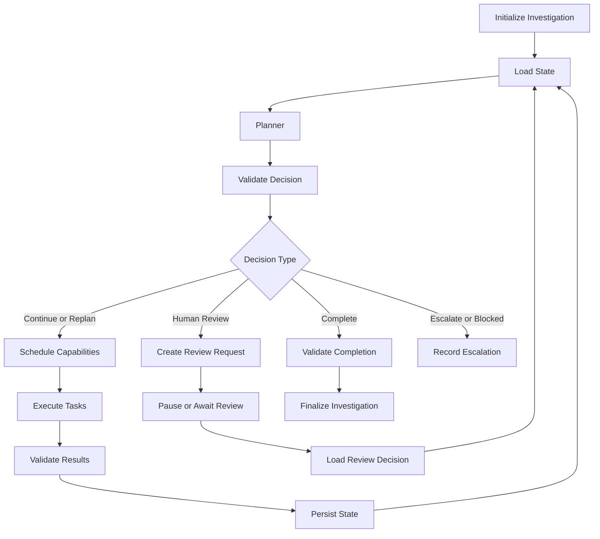

# Project Sentinel
# End-to-End System Integration & Implementation Blueprint

**Document Type:** System Integration and Implementation Specification  
**Version:** 1.0  
**Status:** Proposed Implementation Baseline

---

## 1. Purpose

This document connects the previously defined Project Sentinel subsystems into one coherent implementation architecture.

Individual specifications define the behavior of specific components. This document explains how those components interact, which subsystem owns each responsibility, how data moves through the platform, and in what order the system should be implemented.

The primary objective is to implement a working cybersecurity investigation platform around:

**Planner + Specialized Workers with dynamic, non-linear orchestration.**

The Planner must dynamically determine which capabilities are needed, evaluate their outputs, and decide whether to gather additional evidence, replan, request human review or complete an investigation.

The system must not be implemented as a fixed sequence of agents.

## 2. Implementation Scope

### 2.1 Included in the MVP

- Dataset registration and replay.
- Security-event ingestion and normalization.
- Hybrid rule-based and ML-based detection.
- Entity and temporal correlation.
- Incident candidate generation.
- Dynamic Planner-based orchestration.
- Specialized worker execution.
- RAG-based cybersecurity knowledge retrieval.
- Investigation state management.
- Evidence collection and provenance.
- Automated report generation.
- Human review and approval.
- Response simulation.
- SOC analyst dashboard.
- Evaluation against cybersecurity datasets.

### 2.2 Excluded from the MVP

- Live enterprise SIEM integration.
- Autonomous production containment.
- Unrestricted shell or operating-system access for agents.
- Multi-tenant enterprise deployment.
- Fully automated threat intelligence subscriptions.
- Production endpoint isolation.
- Production firewall modifications.

These features may be considered after the core system is validated.

---

## 3. Final Technology Stack

| Layer | Technology | Responsibility |
|---|---|---|
| Frontend | React + Vite | SOC analyst interface |
| Backend | FastAPI | REST API and application services |
| Orchestration | LangGraph | Planner and worker coordination |
| LLM runtime | Ollama | Local language model inference |
| Relational database | PostgreSQL | Durable application state |
| Cache and coordination | Redis | Task coordination and transient state |
| Vector database | ChromaDB | Knowledge retrieval |
| ORM | SQLAlchemy | Database persistence |
| Migrations | Alembic | Schema evolution |
| Containerization | Docker Compose | Local deployment |
| Evaluation | Python-based evaluation modules | Quantitative system validation |

All components should communicate through defined interfaces rather than directly accessing each other's internal implementation.

---

## 4. Integrated System Architecture

```text
                     SOC ANALYST
                          |
                          v
                   REACT DASHBOARD
                          |
                          v
                    FASTAPI BACKEND
                          |
          +---------------+----------------+
          |               |                |
          v               v                v
     Alert Service   Investigation      Review Service
                          Service
                          |
                          v
                 ORCHESTRATION RUNTIME
                          |
                    +-----+-----+
                    |  PLANNER  |
                    +-----+-----+
                          |
                 Dynamic Task Selection
                          |
          +---------------+------------------+
          |               |                  |
          v               v                  v
     DETECTION        CORRELATION       INVESTIGATION
       WORKER           WORKER             WORKER
          |               |                  |
          +---------------+------------------+
                          |
                    +-----+-----+
                    | RAG / KB  |
                    +-----+-----+
                          |
                          v
                   REPORTING WORKER
                          |
                          v
                  RESPONSE SIMULATION
                          |
                          v
                    HUMAN REVIEW
                          |
                          v
                    INVESTIGATION
                       CLOSURE

     --------------------------------------------
                   PERSISTENCE LAYER
     --------------------------------------------

          PostgreSQL | Redis | ChromaDB
```

The diagram represents the major components, not a mandatory execution sequence. The Planner can invoke, revisit or skip capabilities based on the current investigation state.

---

## 5. Subsystem Ownership and Integration Contracts

| Subsystem | Primary responsibility | Receives | Produces |
|---|---|---|---|
| Dataset Manager | Register source datasets | Dataset files and metadata | Dataset records |
| Replay Engine | Replay telemetry | Registered dataset | Event batches |
| Ingestion Service | Validate and normalize events | Raw records | SecurityEvents |
| Detection Engine | Identify suspicious activity | SecurityEvents | Detection findings |
| Correlation Engine | Associate related activity | Findings and events | Incident candidates |
| Investigation Service | Manage investigation lifecycle | Analyst request or candidate | Investigation |
| Planner | Determine next action | Investigation state | Structured decision |
| Capability Registry | Validate available operations | Capability request | Authorized capability |
| Task Executor | Execute tasks | Validated task | Task result |
| Specialized Workers | Perform domain-specific analysis | Task input | Structured output |
| RAG Service | Retrieve cybersecurity knowledge | Search query and filters | Grounded knowledge |
| Evidence Service | Maintain investigation evidence | Evidence references | Evidence records |
| Reporting Service | Generate reports | Investigation and evidence | Report |
| Review Service | Manage analyst decisions | Review request | Approval or rejection |
| Response Service | Simulate response actions | Approved action | Simulation result |
| Evaluation Service | Measure system performance | Ground truth and outputs | Metrics |

### 5.1 Integration rule

The API should communicate with application services.

Application services should communicate with the orchestration runtime.

The Planner should communicate through the capability registry and executor.

Workers should communicate through defined service interfaces.

No frontend component should call an agent or worker directly.

---

## 6. End-to-End Data Flow

### 6.1 Dataset ingestion

```text
Dataset File
    |
    v
Dataset Registration
    |
    v
File Validation
    |
    v
Replay Session
    |
    v
Replay Engine
    |
    v
Ingestion API
    |
    v
Normalization
    |
    v
SecurityEvent Persistence
```

Responsibilities:

1. Dataset Manager registers the dataset.
2. Dataset files are validated.
3. Replay Engine creates a replay session.
4. Records are read in controlled batches.
5. Ingestion Service validates and normalizes records.
6. Normalized events are persisted.
7. Rejected records are recorded for diagnostics.
8. Ground-truth labels remain isolated from inference-facing processing.

### 6.2 Detection and correlation

```text
SecurityEvents
      |
      v
Detection Engine
      |
      +------------------+
      |                  |
      v                  v
  Rule Engine          ML Model
      |                  |
      +--------+---------+
               |
               v
       Detection Findings
               |
               v
       Correlation Engine
               |
       Entity Resolution
               |
       Temporal Analysis
               |
               v
      Incident Candidates
```

The Detection Engine identifies suspicious activity.

The Correlation Engine determines whether multiple observations are related.

The output is an incident candidate containing associated findings, entities, timestamps and correlation information.

The correlation engine must not treat every suspicious finding as an independent confirmed incident.

### 6.3 Investigation initiation

An investigation can begin through:

- Analyst-created investigation.
- Incident candidate escalation.
- Explicit analyst request for further analysis.

The Investigation Service creates the investigation record and initializes its state.

The initial state should contain:

- Investigation identifier.
- Trigger information.
- Initial findings.
- Initial evidence references.
- Known entities.
- Initial hypotheses, if available.
- Unresolved questions.
- Execution constraints.
- Completion criteria.

### 6.4 Dynamic orchestration

The Planner receives the latest investigation state.

It evaluates:

- Known facts.
- Evidence completeness.
- Unresolved questions.
- Current hypotheses.
- Previous task results.
- Available capabilities.
- Investigation constraints.
- Remaining execution budget.

It then produces a structured decision.

Example:

```json
{
  "decision_type": "continue_investigation",
  "reasoning_summary": "Additional temporal correlation is required.",
  "tasks": [
    {
      "capability": "correlation.analyze_temporal_patterns",
      "priority": 1
    },
    {
      "capability": "knowledge.retrieve_attack_techniques",
      "priority": 2
    }
  ],
  "unresolved_questions": [
    "Are the observed events part of one attack sequence?"
  ]
}
```

This is an illustrative decision payload.

The Planner may subsequently decide to:

- Gather more telemetry evidence.
- Revisit correlation.
- Request additional knowledge.
- Investigate a specific entity.
- Generate a report.
- Request human review.
- Complete the investigation.
- Escalate or mark the investigation blocked.

### 6.5 Task execution

```text
Planner Decision
       |
       v
Decision Validation
       |
       v
Capability Registry
       |
       v
Permission Validation
       |
       v
Task Creation
       |
       v
Task Executor
       |
       v
Specialized Worker
       |
       v
Output Validation
       |
       v
Persistence
       |
       v
Investigation State Update
       |
       v
Planner Re-evaluation
```

The Planner must not directly execute arbitrary operations.

Every task must be validated against:

- Capability availability.
- Capability version.
- Input schema.
- Permission requirements.
- Risk classification.
- Resource limits.
- Human approval requirements.

### 6.6 Reporting and response

Once the Planner determines that sufficient investigation evidence exists:

1. Reporting capability is invoked.
2. Report content is generated from persisted investigation state and evidence.
3. Claims are linked to supporting evidence.
4. The report is validated.
5. Response simulation may be proposed.
6. Human review is requested where required.
7. The decision and outcome are persisted.
8. The investigation is completed or remains open according to the state machine.

---

## 7. Investigation State Integration

The investigation state is the central coordination object.

It must be structured and versioned.

Illustrative representation:

```json
{
  "investigation_id": "uuid",
  "status": "investigating",
  "state_version": 4,
  "facts": [],
  "entities": [],
  "evidence_refs": [],
  "knowledge_refs": [],
  "hypotheses": [],
  "unresolved_questions": [],
  "tasks": [],
  "planner_decisions": [],
  "constraints": {
    "response_mode": "simulation_only",
    "max_task_count": 20,
    "max_planner_cycles": 10
  },
  "completion": {
    "is_complete": false,
    "reason": null
  }
}
```

The exact limits must be configurable.

### 7.1 State ownership

| Component | State responsibility |
|---|---|
| Investigation Service | Authoritative investigation lifecycle |
| State Manager | Versioned state updates |
| Planner | Read state and propose decisions |
| Task Executor | Update task lifecycle |
| Workers | Return structured results |
| Evidence Service | Persist evidence references |
| Review Service | Persist review decisions |

The Planner should not independently modify arbitrary database records.

### 7.2 State update requirements

Every meaningful update must:

1. Load the latest state.
2. Validate the expected version.
3. Validate the proposed mutation.
4. Persist the updated state.
5. Create a state-version record.
6. Record the corresponding investigation event.
7. Commit the transaction.

Concurrent updates must be handled using optimistic concurrency control.

---

## 8. LangGraph Integration Design

LangGraph should implement the orchestration runtime, not replace the application's business persistence layer.

### 8.1 Recommended logical graph



### 8.2 Graph responsibilities

**Initialize node**
- Load investigation.
- Validate its status.
- Load current state.

**Planner node**
- Evaluate current investigation state.
- Select next action.
- Return structured decision.

**Validation node**
- Validate Planner output.
- Check capability permissions.
- Check resource constraints.
- Reject invalid plans.

**Execution node**
- Schedule approved tasks.
- Execute independent tasks concurrently when safe.
- Persist task results.

**State update node**
- Merge validated results.
- Update hypotheses and evidence references.
- Record state changes.

**Review node**
- Create human-review request.
- Wait for an authorized decision.
- Resume only after a valid decision.

**Completion node**
- Check completion conditions.
- Ensure required report and evidence artifacts exist.
- Finalize the investigation.

### 8.3 Checkpointing

LangGraph checkpointing should support:

- Paused investigations.
- Interrupted tasks.
- Human review.
- Planner retries.
- Recovery after service restarts.

PostgreSQL remains the authoritative application state store.

---

## 9. API Integration Contracts

The API contract specification defines the detailed request and response schemas. This section maps those endpoints to the integration workflow.

| API operation | Application service | Main result |
|---|---|---|
| Register dataset | Dataset Service | Dataset record |
| Start replay | Replay Service | Replay session |
| List alerts | Alert Service | Alert collection |
| Create investigation | Investigation Service | Investigation |
| Get investigation | Investigation Service | Investigation state |
| Pause investigation | Orchestration Service | Updated state |
| Resume investigation | Orchestration Service | Resumed execution |
| Submit analyst instruction | Investigation Service | Planner request |
| Get task history | Task Service | Task records |
| Get evidence | Evidence Service | Evidence collection |
| Request review | Review Service | Review record |
| Submit review decision | Review Service | Updated review |
| Get report | Reporting Service | Report |
| Get system health | Health Service | Component status |

The frontend should receive stable application-level API contracts, not internal LangGraph node identifiers.

### 9.1 Asynchronous execution

Long-running tasks should not hold HTTP requests open.

Recommended behavior:

1. API receives an analyst request.
2. API validates authorization.
3. Application service creates a durable task or investigation event.
4. API returns an identifier.
5. Orchestration runs asynchronously.
6. Frontend polls or receives updates.
7. Frontend retrieves the latest persisted state.

---

## 10. Database and Infrastructure Integration

### PostgreSQL

Owns:

- Investigations.
- Events.
- Findings.
- Tasks.
- Evidence.
- Reports.
- Audit logs.
- Evaluation records.

### Redis

Supports:

- Task dispatch.
- Short-lived locks.
- Worker coordination.
- Temporary queue state.
- Cache.

### ChromaDB

Supports:

- Knowledge embeddings.
- Similarity search.
- Retrieval metadata.

### Ollama

Provides:

- Planner inference.
- Worker inference.
- Structured generation where required.

### Integration constraints

- PostgreSQL transactions must remain short.
- Redis messages must be idempotently handled.
- ChromaDB failures must not erase canonical knowledge records.
- Ollama timeouts must be handled by the orchestration runtime.
- No external component should silently become the authoritative investigation store.

---

## 11. Failure Handling and Recovery

| Failure | Expected behavior |
|---|---|
| PostgreSQL unavailable | Stop durable state mutations |
| Redis unavailable | Preserve durable tasks and recover dispatch later |
| ChromaDB unavailable | Continue without retrieval only if the task permits it |
| Ollama unavailable | Retry within limits or mark task blocked |
| Worker crashes | Persist failed attempt and apply retry policy |
| Planner returns invalid output | Reject decision and record validation failure |
| Task times out | Mark attempt timed out and apply retry policy |
| Review service unavailable | Keep sensitive actions blocked |
| Frontend disconnects | Backend investigation continues independently |
| Container restarts | Recover from durable state and checkpoints |

### 11.1 Recovery requirements

The system must distinguish:

- Retryable failure.
- Non-retryable failure.
- Blocked task.
- Cancelled task.
- Completed task.

A retry must not blindly duplicate side effects.

For MVP response simulations, execution should be idempotent and non-destructive.

---

## 12. Integration Test Strategy

### 12.1 Component integration tests

| Test | Expected result |
|---|---|
| Dataset Manager → Replay Engine | Replay session starts correctly |
| Replay Engine → Ingestion | Event batches received |
| Ingestion → PostgreSQL | Normalized events persisted |
| Detection → Correlation | Findings available for correlation |
| Correlation → Investigation | Candidate can initiate investigation |
| Investigation → Planner | Correct state is loaded |
| Planner → Registry | Capabilities validated |
| Registry → Executor | Authorized task executes |
| Worker → State Manager | Output persisted |
| State Manager → Planner | Updated state triggers reevaluation |
| RAG → Investigation | Knowledge references are traceable |
| Reporting → Evidence | Report claims reference evidence |
| Review → Response Simulation | Only authorized simulation proceeds |

### 12.2 End-to-end tests

**E2E-01: Dataset replay**

- Register a dataset.
- Start replay.
- Verify normalized events.
- Verify replay counters.

**E2E-02: Detection**

- Process known test events.
- Verify expected detection findings.
- Verify detection provenance.

**E2E-03: Correlation**

- Provide related findings.
- Verify entity and temporal associations.
- Verify incident candidate generation.

**E2E-04: Dynamic investigation**

- Create an investigation.
- Verify Planner initialization.
- Verify capability selection.
- Verify task execution.
- Verify state updates.
- Verify Planner reevaluation.

**E2E-05: Replanning**

- Provide an incomplete investigation result.
- Verify that the Planner requests additional analysis.
- Verify that the system does not prematurely terminate.

**E2E-06: Human review**

- Generate a review request.
- Verify analyst approval.
- Verify that approval is linked to the requested action.
- Verify response simulation.

**E2E-07: Recovery**

- Interrupt a task.
- Restart the relevant service.
- Verify investigation recovery.
- Verify duplicate execution is prevented.

**E2E-08: Ground-truth isolation**

- Execute normal inference.
- Verify that the detection and Planner services cannot access evaluation labels.

---

## 13. Implementation Dependency Graph

The implementation should follow dependencies rather than document order.

```text
Database Foundation
       |
       v
Identity + Dataset Management
       |
       v
Replay + Ingestion
       |
       v
SecurityEvent Model
       |
       v
Detection Engine
       |
       v
Correlation Engine
       |
       v
Investigation Persistence
       |
       v
Capability Registry
       |
       v
Task Executor
       |
       v
Planner + LangGraph Runtime
       |
       +------------------+
       |                  |
       v                  v
      RAG              Evidence
       |                  |
       +--------+---------+
                |
                v
           Reporting
                |
                v
        Human Review Layer
                |
                v
       Response Simulation
                |
                v
          Frontend Integration
                |
                v
         Evaluation and Demo
```

Some development can happen in parallel:

- Frontend wireframes can begin while backend contracts are being finalized.
- RAG ingestion can be developed alongside detection.
- Evaluation infrastructure can be developed alongside orchestration.
- Observability can be integrated incrementally.

The graph is a dependency guide, not a rigid execution pipeline.

---

## 14. Recommended Repository Organization

The following is a proposed structure. Existing repository structure must be inspected before moving or renaming files.

```text
project-sentinel/
│
├── backend/
│   ├── app/
│   │   ├── api/
│   │   │   └── v1/
│   │   ├── core/
│   │   ├── db/
│   │   ├── models/
│   │   ├── schemas/
│   │   ├── repositories/
│   │   ├── services/
│   │   │   ├── datasets/
│   │   │   ├── ingestion/
│   │   │   ├── detection/
│   │   │   ├── correlation/
│   │   │   ├── investigation/
│   │   │   ├── evidence/
│   │   │   ├── knowledge/
│   │   │   └── reporting/
│   │   ├── agents/
│   │   │   ├── planner/
│   │   │   ├── workers/
│   │   │   └── registry/
│   │   ├── orchestration/
│   │   ├── evaluation/
│   │   └── main.py
│   │
│   ├── tests/
│   ├── alembic/
│   ├── requirements.txt
│   └── Dockerfile
│
├── frontend/
│   ├── src/
│   │   ├── api/
│   │   ├── components/
│   │   ├── features/
│   │   ├── pages/
│   │   ├── hooks/
│   │   ├── types/
│   │   └── App.jsx
│   ├── package.json
│   └── Dockerfile
│
├── datasets/
│   ├── raw/
│   ├── processed/
│   └── metadata/
│
├── configs/
│   ├── detection/
│   ├── orchestration/
│   └── evaluation/
│
├── docs/
│
├── scripts/
│
├── docker-compose.yml
├── .env.example
└── README.md
```

Do not duplicate the same business logic across API routes, agents and frontend components.

---

## 15. Milestone-Based Implementation Plan

### Milestone 1 — Infrastructure foundation

**Tasks**
- PostgreSQL setup.
- Redis setup.
- ChromaDB setup.
- Ollama setup.
- Docker Compose configuration.
- FastAPI startup.
- React/Vite startup.
- Health checks.

**Exit criteria:** All required services start and communicate.

### Milestone 2 — Data ingestion

**Tasks**
- Inspect selected CSE-CIC-IDS2018 files.
- Identify source fields.
- Register dataset metadata.
- Implement replay.
- Implement normalization.
- Persist SecurityEvents.

**Exit criteria:** A dataset can be replayed into PostgreSQL with traceable records.

### Milestone 3 — Detection and correlation

**Tasks**
- Implement baseline rules.
- Integrate ML detection.
- Persist findings.
- Implement entity resolution.
- Implement temporal correlation.
- Generate incident candidates.

**Exit criteria:** Suspicious activity can be detected and grouped into candidates.

### Milestone 4 — Investigation runtime

**Tasks**
- Implement investigation state.
- Implement state transitions.
- Implement capability registry.
- Implement task executor.
- Implement task persistence.
- Integrate LangGraph.
- Implement Planner.
- Implement checkpoint recovery.

**Exit criteria:** A Planner can dynamically schedule and execute multiple capabilities, revisit tasks and update investigation state.

### Milestone 5 — RAG and evidence

**Tasks**
- Ingest approved knowledge sources.
- Implement chunking and embeddings.
- Integrate ChromaDB.
- Implement retrieval.
- Implement evidence persistence.
- Integrate evidence into investigation state.

**Exit criteria:** Investigations can retrieve grounded cybersecurity knowledge and retain source references.

### Milestone 6 — Reporting and human oversight

**Tasks**
- Implement reporting worker.
- Implement report validation.
- Implement human review.
- Implement response simulation.
- Implement audit records.

**Exit criteria:** Investigations produce reports and safely simulate approved response actions.

### Milestone 7 — Frontend integration

**Tasks**
- Connect dashboard to API.
- Implement alerts.
- Implement investigation workspace.
- Implement timeline and evidence views.
- Implement agent activity.
- Implement human-review workflow.
- Implement report viewer.

**Exit criteria:** An analyst can manage an investigation through the UI.

### Milestone 8 — Evaluation and final validation

**Tasks**
- Execute benchmark scenarios.
- Compare baseline architectures.
- Evaluate detection metrics.
- Evaluate Planner performance.
- Evaluate evidence completeness.
- Run recovery tests.
- Run security tests.
- Prepare demonstration dataset and scenarios.

**Exit criteria:** End-to-end workflows are reproducible and measurable.

---

## 16. Integration Priorities

When implementation time is constrained, prioritize the following:

| Priority | Capability | Reason |
|---|---|---|
| P0 | Dataset replay and ingestion | Required input to the system |
| P0 | Detection and correlation | Produces investigation candidates |
| P0 | Investigation persistence | Required for reliable orchestration |
| P0 | Planner and capability execution | Core architectural differentiator |
| P0 | Evidence collection | Required for defensible conclusions |
| P1 | RAG | Improves cybersecurity knowledge grounding |
| P1 | Reporting | Produces analyst-facing outcomes |
| P1 | Human review | Enforces oversight |
| P1 | Response simulation | Demonstrates response workflow |
| P1 | Frontend integration | Makes the system usable |
| P2 | Advanced analytics | Additional evaluation and insight |
| P2 | Enterprise integrations | Outside the MVP |

P0 means essential for a minimum working end-to-end implementation. P1 means essential for a complete project demonstration. P2 means deferred enhancement.

---

## 17. Definition of an Integrated MVP

The integrated MVP is complete when the following workflow succeeds:

1. An analyst registers a supported cybersecurity dataset.
2. The replay engine processes selected records.
3. The ingestion service normalizes the records.
4. The detection engine generates suspicious findings.
5. The correlation engine identifies related activity.
6. An incident candidate is generated.
7. An investigation is created.
8. The Planner examines its current state.
9. The Planner selects capabilities dynamically.
10. The capability registry validates each proposed task.
11. Workers execute the authorized tasks.
12. Evidence and task outputs are persisted.
13. The Planner reevaluates the updated investigation.
14. Additional capabilities are invoked when required.
15. The system retrieves relevant cybersecurity knowledge.
16. A report is generated with evidence references.
17. A response simulation is proposed where appropriate.
18. The analyst reviews the result.
19. The investigation is completed and retained.
20. Evaluation metrics are calculated against isolated ground truth.

A successful implementation must demonstrate at least one investigation in which the Planner makes a meaningful non-linear decision, rather than simply executing a fixed chain.

---

## 18. Final Architectural Position

The Project Sentinel implementation should be organized around a durable investigation state and a dynamic orchestration runtime.

The integration contract is:

**Data ingestion produces normalized telemetry. Detection produces findings. Correlation produces incident candidates. Investigation creates durable analytical state. The Planner selects capabilities dynamically. Workers produce structured results. Evidence and knowledge ground the investigation. Reporting communicates conclusions. Human oversight controls sensitive actions. Evaluation measures system performance.**

The core differentiator is not the number of agents.

It is the ability of the Planner to select, sequence, revisit and terminate specialized capabilities based on the evolving evidence and unresolved questions of an investigation.

Implementation should preserve that differentiator from the beginning rather than adding a Planner to an already fixed workflow.
