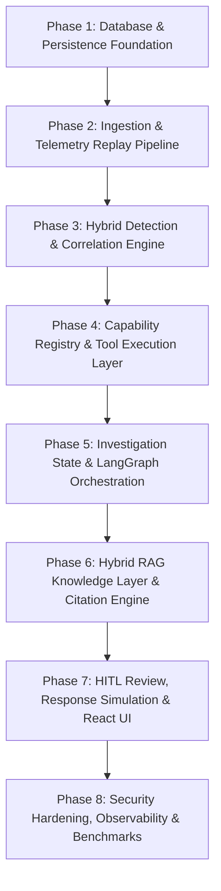

# Project Sentinel — Master Project Upgrade & Implementation Plan

**Document Type:** Master Implementation & Upgradation Roadmap  
**Version:** 1.0  
**Status:** Approved Implementation Baseline  
**Target System:** Agentic AI-Powered Autonomous Threat Hunting Platform (CDAC Problem Statement Sr. No. 25)

---

## 1. Executive Summary & Upgrade Objectives

Project Sentinel is transitioning from an initial proof-of-concept prototype into a **production-hardened, non-linear, multi-agent cybersecurity investigation platform**.

Across 40+ formal technical design specifications, the architectural foundation has been established around the **Planner + Specialized Workers** model. The core upgrade objective is to eliminate hardcoded execution pipelines and replace them with an **adaptive, evidence-driven investigation control loop**:

$$\text{Telemetry Replay} \longrightarrow \text{Detection} \longrightarrow \text{Correlation} \longrightarrow \text{Candidate Handoff} \longrightarrow \text{Dynamic LangGraph Planner} \longleftrightarrow \text{Capability Registry & Workers}$$

### Core Upgradation Goals:
1. **Durable Relational Truth (PostgreSQL)**: Transition all investigation state, evidence, task attempts, and checkpoints to the 14-domain relational schema with optimistic concurrency and Alembic migrations.
2. **Deterministic Capability Boundary**: Enforce strict separation between AI reasoning and execution via a central Capability Registry with Pydantic contracts and zero arbitrary shell/SQL authority.
3. **Hybrid Detection & Correlation**: Ingest real CSE-CIC-IDS2018 telemetry via a multi-mode Replay Engine; evaluate attacks with hybrid rules + ML, and cluster events into structured `IncidentCandidate` records.
4. **Epistemic RAG & Citation Enforcement**: Implement hybrid dense vector + exact keyword retrieval in ChromaDB with strict separation of empirical evidence (`evidence_refs`) from contextual knowledge (`knowledge_refs`).
5. **Human-on-the-Loop (HITL) Safety**: LangGraph review interrupts, strictly simulated response playbooks, and immutable audit logs.
6. **Empirical Evaluation (PS-TEST-001)**: Execute rigorous benchmark comparisons evaluating dynamic orchestration ($P_1$) against traditional baselines ($B_0$ to $B_3$) on Orchestration Quality Score ($OQS$).

---

## 2. Current Codebase Audit & Gap Analysis

| Component | Current State (Baseline PoC) | Target State (Upgraded Architecture) | Gap & Required Upgrades |
|---|---|---|---|
| **Database & Persistence** | In-memory SQLite / mock dictionaries in `backend/app/database.py` | PostgreSQL 15 with 14 relational domains, Alembic migrations, transactional outbox (`outbox_events`) | Implement full SQLAlchemy 2.0 models, migrations, optimistic locking (`state_version`), and outbox dispatcher. |
| **Telemetry Ingestion** | Basic CSV loading in `backend/app/ingest/` | Multi-mode Replay Engine (`instant`, `timed`, `timestamp`, `step`), canonical `SecurityEvent` model, quarantine ledger | Build dataset adapter registry (`cicids2018.py`), deduplication checksums, and ground-truth isolation. |
| **Detection & Correlation** | Simple keyword/rule matching | Hybrid rule engine + offline ML inference, entity resolution, temporal windowing, correlation scoring | Build feature extractor, model inference wrapper, entity normalizer, and `IncidentCandidate` generator. |
| **Agent Orchestration** | Sequential/hardcoded execution cycle in `backend/app/planner/` | Dynamic 10-node LangGraph control loop, Plan Validator, loop prevention, replanning bounds | Implement stateful LangGraph runtime with durable checkpoints and runtime completion validator. |
| **Capability Execution** | Direct function calls in `backend/app/workers/` | Central Capability Registry (`CapabilityRegistry`), Pydantic input/output contracts, task attempt tracking | Decouple workers into registered capabilities with permission tokens, risk tiers, and idempotency keys. |
| **RAG Knowledge Base** | Basic ChromaDB collection in `backend/app/knowledge/` | Hybrid dense vector + exact identifier search, structure-aware chunking, prompt injection delimiters | Implement dual-path retrieval (vector + BM25/keyword), document hashing, and citation validator. |
| **Human-in-the-Loop** | Direct auto-execution of actions | LangGraph review interrupts, simulated response playbooks, immutable audit logs | Add review request queue, state transition guards, and simulation-only containment engine. |
| **Frontend Studio** | Static mock components in `frontend/src/components/` | React 18 / TypeScript Vite SOC Studio with 3-level progressive disclosure and real-time state sync | Connect UI components to live FastAPI WebSocket/REST endpoints, wire up orbital graph and timeline. |
| **Testing & Evaluation** | Basic unit tests in `backend/tests/` | 5-level testing hierarchy, formal $B_0$–$B_3$ vs $P_1$ comparative benchmark, $OQS$ metric suite | Implement automated evaluation runner calculating Precision, Recall, $OQS$, and 7-factor ablation. |

---

## 3. Upgradation Roadmap: 8 Execution Phases

---

### Phase 1: Database Foundation & Schema Migration
**Specifications:** `DATABASE_SCHEMA_AND_PERSISTENCE_ARCHITECTURE_SPEC.md`, `DATABASE_AND_PERSISTENCE_DESIGN_SPEC.md`
- **Objective:** Establish the persistent PostgreSQL 15 schema across all 14 logical domains.
- **Key Tasks:**
  1. Configure SQLAlchemy 2.0 async engine and session lifecycle in `backend/app/db/session.py`.
  2. Implement ORM models across core domains:
     - Identity: `User`, `Role`, `UserRole`
     - Dataset: `Dataset`, `DatasetFile`, `ReplaySession`, `GroundTruthLabel`
     - Telemetry: `SecurityEvent` (canonical normalized representation)
     - Detection & Correlation: `DetectionRule`, `ModelVersion`, `DetectionFinding`, `Entity`, `EntityRelationship`, `IncidentCandidate`
     - Investigation: `Investigation`, `InvestigationStateVersion`, `InvestigationEvent`, `Hypothesis`, `Evidence`
     - Orchestration: `PlannerRun`, `PlannerDecision`, `Capability`, `CapabilityVersion`, `AgentTask`, `TaskAttempt`, `TaskDependency`, `OrchestrationCheckpoint`, `OutboxEvent`
     - Oversight & Audit: `HumanReview`, `ResponseSimulation`, `Report`, `AuditLog`, `EvaluationRun`, `EvaluationResult`
  3. Initialize Alembic migration hierarchy in `backend/alembic/` with reversible migrations.
  4. Implement optimistic locking validation (`current_state_version`) and transactional outbox.
- **Verification Gate:** Alembic migrations apply cleanly from scratch; database health probes pass.

---

### Phase 2: Ingestion, Replay & Canonical Event Pipeline
**Specifications:** `DETECTION_AND_CORRELATION_ENGINE_SPEC.md`, `DATA_INGESTION_AND_TELEMETRY_PROCESSING_SPEC.md`, `DATA_MANAGEMENT_DATASET_GOVERNANCE_AND_TELEMETRY_LIFECYCLE_SPEC.md`
- **Objective:** Transform raw CSE-CIC-IDS2018 datasets into canonical, traceable security events.
- **Key Tasks:**
  1. Build `DatasetRegistry` tracking dataset files, row counts, and SHA-256 checksums.
  2. Implement `DatasetReplayEngine` supporting `instant`, `timed`, `timestamp`, `scenario`, and `step` replay modes.
  3. Develop dataset-specific adapter `Cicids2018Adapter` mapping raw CSV fields into the canonical `SecurityEvent` schema.
  4. Add record validation and quarantine ledger for malformed rows.
  5. Strictly quarantine ground-truth attack labels into `ground_truth_labels` (isolated from runtime inference).
- **Verification Gate:** Replaying `Wed-14-02-2018_BruteForce.csv` produces reproducible, idempotent `SecurityEvent` rows in PostgreSQL.

---

### Phase 3: Hybrid Detection & Multi-Dimensional Correlation Engine
**Specifications:** `DETECTION_AND_CORRELATION_ENGINE_SPEC.md`, `DETECTION_CORRELATION_AND_INVESTIGATION_ENGINE_SPEC.md`
- **Objective:** Detect malicious activities and correlate events into structured incident candidates.
- **Key Tasks:**
  1. Implement deterministic `RuleDetectionEngine` for threshold signatures (brute-force, port scanning, abnormal flows).
  2. Implement `MLDetectionEngine` evaluating pre-trained model artifacts (Random Forest / Logistic Regression) on extracted flow features.
  3. Build `FindingAggregator` consolidating detector outputs while preserving individual provenance.
  4. Develop `EntityResolver` normalizing IPs, ports, hosts, and accounts.
  5. Implement `TemporalCorrelationEngine` with multi-factor scoring:
     $$C = w_e E + w_t T + w_a A + w_f F$$
  6. Assemble correlated event clusters into `IncidentCandidate` records and implement idempotent handoff to the Planner.
- **Verification Gate:** Brute-force events trigger detection findings, correlate by target IP within time window, and produce validated `IncidentCandidate`.

---

### Phase 4: Capability Registry & Pydantic Tool Execution Layer
**Specifications:** `AGENT_CAPABILITY_REGISTRY_AND_TOOL_EXECUTION_SPEC.md`, `CAPABILITY_AND_TOOL_IMPLEMENTATION_SPEC.md`
- **Objective:** Create a secure, registry-mediated operational boundary between AI planning and tool execution.
- **Key Tasks:**
  1. Build central `CapabilityRegistry` maintaining versioned metadata, input/output schemas, and risk tiers.
  2. Implement initial 12 capability contracts using strict Pydantic models:
     - `event_search`, `run_detection`, `inspect_findings`
     - `correlate_events`, `resolve_entities`, `build_timeline`
     - `analyze_evidence`, `retrieve_knowledge`, `retrieve_history`
     - `generate_report`, `recommend_response`, `simulate_response`
  3. Implement `CapabilityExecutor` enforcing least-privilege permission checks, timeouts, and idempotency keys.
  4. Persist execution attempts in `task_attempts` and validate all worker outputs before committing to state.
  5. Enforce zero-trust security invariants: absolute ban on arbitrary shell execution or raw SQL generation.
- **Verification Gate:** Unregistered capabilities and schema-violating inputs are rejected; valid capabilities execute idempotently.

---

### Phase 5: Investigation State Machine & LangGraph Orchestration Runtime
**Specifications:** `INVESTIGATION_STATE_MACHINE_AND_ORCHESTRATION_RUNTIME_SPEC.md`, `AI_AGENT_ORCHESTRATION_AND_PLANNER_IMPLEMENTATION_SPEC.md`
- **Objective:** Implement the core dynamic, non-linear Planner control loop.
- **Key Tasks:**
  1. Implement the dual state machines:
     - Investigation Lifecycle (11 states: `created` $\to$ `investigating` $\to$ `awaiting_review` $\to$ `completed`)
     - Task Lifecycle (11 states: `proposed` $\to$ `pending` $\to$ `running` $\to$ `completed` / `retrying`)
  2. Build stateful LangGraph 10-node workflow:
     $$\text{Load State} \to \text{Build Context} \to \text{Planner} \to \text{Plan Validator} \to \text{Dispatch Tasks} \to \text{Execute Workers} \to \text{Update State} \to \text{Checkpoint} \to \text{Re-evaluate}$$
  3. Implement `PlanValidator` verifying proposal structure, budget limits (max 20 tasks, max 10 replans), and capability availability.
  4. Implement `DynamicReplanner` triggered by new evidence, contradictions, or failed tasks.
  5. Implement `CompletionValidator` ensuring required evidence is collected before concluding.
  6. Configure LangGraph checkpointer for crash resilience and application restart recovery.
- **Verification Gate:** Planner successfully replans when incomplete evidence is presented and halts dynamically when stopping criteria are satisfied.

---

### Phase 6: Hybrid RAG Knowledge Layer & Citation Engine
**Specifications:** `RAG_AND_KNOWLEDGE_ENGINEERING_SPEC.md`, `RAG_AND_CYBERSECURITY_KNOWLEDGE_LAYER_SPEC.md`
- **Objective:** Provide grounded security knowledge with strict citation enforcement and prompt injection defense.
- **Key Tasks:**
  1. Ingest cybersecurity knowledge sources (MITRE ATT&CK enterprise techniques, Sigma detection rules, incident playbooks).
  2. Implement structure-aware chunker (500 tokens, 75-token overlap) with metadata hashing.
  3. Build hybrid retrieval pipeline:
     - Dense semantic vector search via ChromaDB (`sentence-transformers/all-MiniLM-L6-v2`)
     - Exact identifier / BM25 matching (technique IDs like `T1110`, CVEs, port numbers)
     - Metadata filtering by domain and confidence
  4. Enforce epistemic separation: telemetry is empirical proof; RAG knowledge is interpretive context.
  5. Implement `CitationValidator`: every agent claim must cite valid `evidence_refs` and `knowledge_refs`.
  6. Sanitize retrieved context inside designated prompt delimiters (`<retrieved_context>`) to block injection.
- **Verification Gate:** Attack techniques are correctly retrieved by ID and semantic query; ungrounded agent assertions are rejected.

---

### Phase 7: Human-in-the-Loop Review, Simulated Response & React Studio UI
**Specifications:** `FRONTEND_ANALYST_EXPERIENCE_AND_HUMAN_IN_THE_LOOP_SPEC.md`, `FRONTEND_AND_ANALYST_EXPERIENCE_SPEC.md`
- **Objective:** Deliver a full SOC analyst workbench with human oversight and transparent investigation visualization.
- **Key Tasks:**
  1. Build FastAPI REST & WebSocket endpoints for real-time investigation streaming.
  2. Implement Human-in-the-Loop review queue:
     - Triggers LangGraph interrupt on high-risk findings or containment recommendations
     - Analysts can Approve, Reject, or Request Additional Evidence
  3. Implement `ResponseSimulationEngine`: simulate containment actions (isolate host, revoke token) without touching live networks.
  4. Wire up React 18 / TypeScript frontend components:
     - **Level 1 (Executive)**: Investigation banner, status pill, tripartite confidence gauges ($D_c, S_a, C_s$).
     - **Level 2 (Workbench)**: Interactive `AttackTimeline`, `EntityGraphCanvas`, `HypothesisMatrix`.
     - **Level 3 (Diagnostic)**: `AgentThoughtStream`, `FactorDecompositionView`, raw audit ledger.
- **Verification Gate:** Analyst approves simulated containment in UI; investigation resumes and logs cryptographic audit record.

---

### Phase 8: Security Hardening, Observability & Experimental Evaluation Benchmark
**Specifications:** `DEPLOYMENT_SECURITY_HARDENING_AND_PRODUCTION_READINESS_SPEC.md`, `TESTING_VALIDATION_AND_EVALUATION_STRATEGY_SPEC.md` (PS-TEST-001)
- **Objective:** Harden the complete stack for production readiness and run scientific evaluation benchmarks.
- **Key Tasks:**
  1. Execute container hardening: non-root `sentinel` user, read-only root filesystems, Docker Compose network isolation.
  2. Run 16-point Security Verification Suite (`SEC-01` to `SEC-16`).
  3. Configure structured JSON logging with correlation IDs (`request_id`, `investigation_id`, `task_id`).
  4. Build automated Evaluation Suite comparing 5 system architectures:
     - $B_0$: Rule-based detection alone
     - $B_1$: Traditional machine learning detection alone
     - $B_2$: Single-agent LLM investigation
     - $B_3$: Fixed-sequence multi-agent workflow
     - $P_1$: Project Sentinel Dynamic Planner multi-agent orchestration
  5. Measure and report Orchestration Quality Score:
     $$OQS = 0.25 R + 0.20 P + 0.25 C + 0.15 F + 0.15 T$$
  6. Execute 7-factor ablation study and record statistical significance (p < 0.05).
- **Verification Gate:** $P_1$ demonstrates statistically superior $OQS$ and lower hallucination rates compared to $B_3$.

---

## 4. Priority Matrix & Implementation Sequencing

| Priority Tier | Components | Implementation Order | Dependency |
|---|---|---|---|
| **Tier 0 (Core Foundation)** | Database schema (SQLAlchemy/Alembic), Canonical SecurityEvent, Dataset Replay Engine | Week 1–2 | None |
| **Tier 1 (Detection & Tools)** | Hybrid Detection, Temporal Correlation, Capability Registry & Pydantic Contracts | Week 3–4 | Tier 0 |
| **Tier 2 (Orchestration Engine)** | LangGraph Control Graph, State Manager, Dynamic Planner, Checkpointer | Week 5–6 | Tier 1 |
| **Tier 3 (Knowledge & Evidence)** | ChromaDB RAG, Hybrid Retrieval, Evidence Ledger, Citation Enforcement | Week 7 | Tier 2 |
| **Tier 4 (Analyst Experience)** | HITL Review Drawer, Response Simulation, React Studio Integration, WebSockets | Week 8 | Tier 3 |
| **Tier 5 (Hardening & Benchmarks)**| Container Hardening, Security Test Suite, B0–B3 vs P1 Evaluation Benchmark | Week 9 | Tier 4 |

---

## 5. Definition of Done for Project Upgrade

The Project Sentinel upgrade is officially complete and production-ready when:
1. All 14 relational domains are managed via versioned Alembic migrations on PostgreSQL.
2. Ingestion replays CSE-CIC-IDS2018 datasets without data loss or ground-truth leakage.
3. The Capability Registry executes all 12 tools through strictly validated Pydantic interfaces.
4. The LangGraph Planner autonomously investigates multi-step attacks, performing non-linear replanning when presented with incomplete evidence.
5. All generated reports and hypotheses cite verified telemetry (`evidence_refs`) and knowledge chunks (`knowledge_refs`).
6. High-risk containment actions trigger human review interrupts and execute strictly as non-destructive simulations.
7. The 16 security tests pass (`SEC-01` to `SEC-16`), verifying total isolation of database credentials and zero shell execution.
8. The evaluation suite runs B0–B3 vs P1 benchmarks, demonstrating empirical superiority on the Orchestration Quality Score ($OQS \ge 0.85$).
